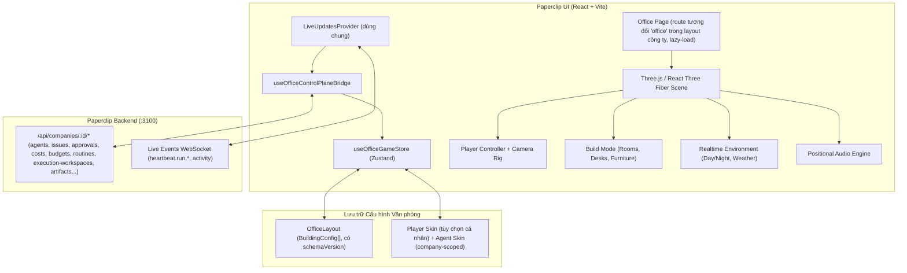

# Bản Kế hoạch Nâng cấp: Paperclip 3D Virtual World (RPG Office Game)

> **Tầm nhìn mới**: Biến Paperclip 3D Office từ một màn hình quan sát thụ động thành một **trò chơi mô phỏng quản lý công ty ảo (RPG Office Game)** native 100% trên giao diện Paperclip.
> Người dùng hóa thân thành một **nhân vật 3D phong cách Voxel/Minecraft** (tùy biến skin mũ, áo, kính), có thể tự do di chuyển (WASD/click), đi thang máy giữa các tầng, tương tác trực tiếp với các Agent, xây dựng tòa nhà (`New Building`), thêm/xóa/đổi tên các phòng và sắp xếp bàn làm việc linh hoạt.

> [!IMPORTANT]
> **Nguyên tắc cốt lõi**: 3D Office chỉ là **một lớp trình bày (presentation layer)** trên Control Plane hiện có. Mọi hành động thực hiện trong thế giới 3D (duyệt, tạm dừng, tuyển agent, giao việc) phải gọi lại **đúng API hiện có** của Paperclip — không tạo đường tắt mới — để giữ nguyên approval gate, kiểm tra quyền, budget hard-stop và activity log.

---

## 1. Đánh giá Khả thi, Công sức & Rủi ro

Ký hiệu công sức: **S** (≤ 3 ngày) · **M** (1–2 tuần) · **L** (> 2 tuần).

| Tính năng | Khả thi | Công sức | Rủi ro / Lưu ý chính |
| :--- | :--- | :--- | :--- |
| **Nhân vật phong cách Minecraft (Voxel)** | Cao | S | Dựng từ 6 khối `BoxGeometry`, texture 64x64. Dùng `InstancedMesh` khi số agent lớn. |
| **Tùy biến Skin (Mũ, kính, áo, màu)** | Cao | S–M | 2-layer skin (Base + Accessory). Skin người chơi là tùy chọn cá nhân; skin agent là dữ liệu company-scoped. |
| **Người chơi điều khiển & tương tác (Player Controller)** | Cao | M | Phải tạm tắt phím tắt toàn cục của `Layout.tsx` khi canvas đang focus để tránh xung đột `WASD`/`E`. |
| **Hệ thống Âm thanh (Audio FX & Positional)** | Cao | S–M | Trình duyệt chặn autoplay: chỉ khởi tạo `AudioContext` sau thao tác đầu tiên; mặc định tắt tiếng. |
| **Đa tầng (Multi-floor) & Tòa nhà (Buildings)** | Cao | M | Cần `id` ổn định cho tầng; thang máy phải cùng một ô lưới ở mọi tầng. |
| **Chế độ Thêm/Sửa/Xóa phòng & bàn (Build Mode)** | Trung bình – Cao | L | Phần lớn nhất của dự án: kéo thả lưới, kiểm tra chồng lấn, cửa phòng, undo/redo, lưu trữ có version. |
| **Tích hợp Control Plane vào không gian 3D** | Cao | M | Dữ liệu đã có sẵn trong `ui/src/api/*`. Rủi ro: phân quyền hiển thị nút hành động, phân biệt `thinking` vs `coding` cần đọc `heartbeat.run.event`. |
| **Môi trường Thời gian thực (Realtime Environment)** | Cao | S | Dùng giờ local của trình duyệt (schema `companies` chưa có timezone). Thời tiết chỉ chọn thủ công, không gọi API ngoài. |
| **UX/QoL (Minimap, Teleport, Overview, Hover Card, Deep link)** | Cao | S–M | Thuần frontend. |
| **Agent tự đi bộ (Handoff, Phòng họp) & Time-lapse Replay** | Trung bình | L | Cần `FloorNavGrid` + A\* và bộ phát lại sự kiện; xếp vào Giai đoạn 6. |
| **Multiplayer presence (thấy avatar user khác)** | Thấp trong V1 | L | Cần kênh presence mới phía server + review quyền riêng tư → **ngoài phạm vi V1**. |

### Tài liệu thiết kế chi tiết bổ sung
* [Tích hợp Control Plane vào 3D Office](file:///c:/Users/OS/Desktop/paperclip/doc/plans/2026-11-24-3d-office-control-plane.md) — Ánh xạ Approvals, Budgets/Costs, Routines, Execution Workspaces, HR/Team Catalog, Artifacts; bảng ánh xạ trạng thái Agent → hoạt ảnh; phân quyền & Interfaces.
* [Môi trường Thời gian thực (Day/Night & Weather)](file:///c:/Users/OS/Desktop/paperclip/doc/plans/2026-11-24-3d-office-realtime-environment.md) — Chu kỳ ánh sáng theo giờ thực, vật liệu phát sáng ban đêm, thời tiết, Tổng kết cuối ngày & Interfaces.
* [Tương tác Agent-to-Agent & Trải nghiệm UX/QoL](file:///c:/Users/OS/Desktop/paperclip/doc/plans/2026-11-24-3d-office-agents-and-ux.md) — Minimap, Quick Teleport, Overview Mode, Hover Card, Deep link, Tự sinh văn phòng từ OrgChart, Handoff/Meeting Room, A\* Pathfinding, Time-lapse Replay & Interfaces.

---

## 2. Kiến trúc Hệ thống & Cơ sở Dữ liệu



**Ghi chú kiến trúc:**
* **Live updates** dùng lại `ui/src/context/LiveUpdatesProvider.tsx` (WebSocket, `ui/src/lib/websocket.ts`) — **không** mở thêm kết nối riêng.
* **Route**: khai báo route tương đối `office` bên trong layout công ty trong `ui/src/App.tsx` (giống `dashboard`, `timeline`), kèm mục Sidebar; trang được `React.lazy` để không ảnh hưởng tốc độ tải các trang khác.
* **Feature flag**: ẩn sau cờ `enableOffice3d` trong Instance Experimental Settings (tương tự `enableNativeRunner`).

---

## 3. Hệ thống Nhân vật & Tùy biến Skin (Voxel Character System)

### 3.1. Cấu trúc Nhân vật
Mỗi nhân vật (cả người chơi và Agent) được cấu tạo từ các khối voxel tiêu chuẩn:
* **Head (Đầu)** + **Head Layer (Mũ, nón, kính, tai nghe)**
* **Torso (Thân)** + **Body Layer (Áo vest CEO, áo hoodie Dev, tạp dề, cà vạt)**
* **Left & Right Arms (Hai tay)**: Animation đung đưa khi đi bộ, gõ phím khi ngồi bàn.
* **Left & Right Legs (Hai chân)**: Animation bước đi theo nhịp.

### 3.2. Bảng Tùy biến Skin (Wardrobe / Skin Customizer)
Người dùng có thể mở menu **"Customize Avatar"** bất cứ lúc nào để chọn:
* **Bộ quần áo (Outfit)**: Áo sơ mi công sở, áo hoodie hacker, vest giám đốc, áo phông tối giản.
* **Phụ kiện đầu (Headwear)**: Kính râm, tai nghe Dev có đèn LED, mũ bảo hiểm kỹ sư QA, kính cận.
* **Bảng màu da & tóc**: Chọn từ **bảng màu định sẵn** (palette key) thay vì nhập mã hex tự do, để đồng bộ với Design System.

### 3.3. Skin mặc định của Agent
* Nếu agent chưa được tùy biến, skin được **sinh tự động và ổn định** từ `agent.role` (ví dụ: `engineer` → hoodie + tai nghe, `qa` → mũ bảo hiểm, `ceo` → vest) và `agent.icon`, có hạt giống (seed) theo `agent.id` để mỗi agent trông khác nhau nhưng không đổi giữa các lần tải.

---

## 4. Cơ chế Gameplay: Điều khiển & Tương tác

### 4.1. Cách thức Điều khiển
* **Di chuyển**: Phím `W, A, S, D` hoặc các phím mũi tên. Hỗ trợ cả **Click-to-Move** (bấm chuột xuống sàn để nhân vật tự động tìm đường đi tới).
* **Camera**: Camera isometric góc chéo 45 độ bám theo người chơi, cuộn chuột để zoom, nhấn chuột phải để xoay 360 độ.
* **Chuyển chế độ RPG / Overview**: phím `V` (không dùng `Tab` để không phá điều hướng bàn phím của trình duyệt) hoặc nút trên HUD.
* **`Esc`**: đóng modal / thoát Build Mode / trả focus khỏi canvas.
* **Phím tắt toàn cục**: khi canvas 3D đang focus, tạm vô hiệu hóa phím tắt toàn cục của Paperclip (`useKeyboardShortcuts` trong `Layout.tsx`); khôi phục khi rời focus.
* **Thiết bị cảm ứng / màn hình nhỏ**: V1 chỉ hỗ trợ **Overview Mode** (chạm để chọn agent/vật thể); RPG Mode là Desktop-only.

### 4.2. Hệ thống Tương tác Thông minh (Proximity Interaction)
Khi người chơi đi lại gần đối tượng trong bán kính 2m:
* **Đến gần Bàn của Agent**:
  * Hiện popup: `Nhấn [E] để tương tác với [Tên Agent]`.
  * Nhấn `E` mở menu hành động:
    * 💬 **Chat trực tiếp với Agent**: Mở cửa sổ hội thoại (tái sử dụng luồng Agent Chat hiện có).
    * 📋 **Giao việc mới (Assign Task)**: Tạo issue mới giao cho agent đó (qua API issues hiện có).
    * 💻 **Soi màn hình (Inspect Monitor)**: Mở **Live Run Transcript / Terminal** (log, tool calls có timestamp) của run hiện tại, kèm danh sách Artifacts và link sang Execution Workspace nếu có.
    * ⏸️ **Tạm dừng / Đánh thức (Pause / Wake)**.
  * Các hành động mà người dùng **không có quyền** sẽ bị ẩn hoặc vô hiệu hóa kèm giải thích.
* **Rê chuột lên Agent (Hover Info Card)**: hiện nhanh tên, vai trò, issue đang làm, thời lượng run, chi phí hôm nay — không cần lại gần.
* **Đến gần Bảng trắng (Whiteboard)**:
  * Nhấn `E` để mở sơ đồ Kanban & tiến độ mục tiêu (Goals) của công ty.
* **Đến gần Thang máy (Elevator)**:
  * Nhấn `E` để mở bảng chọn tầng (`Floor Selector`).
* Các trạm Control Plane khác (Bàn Duyệt Hồ Sơ, Server Rack, Quầy HR, Đồng hồ Routines, Kệ Artifacts): xem [tài liệu Control Plane](file:///c:/Users/OS/Desktop/paperclip/doc/plans/2026-11-24-3d-office-control-plane.md).

---

## 5. Hệ thống Tòa nhà, Đa tầng & Chế độ Xây dựng (Building & Floor System)

### 5.1. Khái niệm Tòa nhà & Đa tầng
Một công ty có thể sở hữu một hoặc nhiều tòa nhà (`Building`), mỗi tòa nhà gồm nhiều tầng (`Floors`).

* **Khởi tạo lần đầu – Tự sinh từ OrgChart (khuyến nghị)**: khi công ty chưa có layout, hệ thống sinh văn phòng dựa trên cây `reportsTo` của agent:
  * Tầng 1: Phòng CEO (agent cấp cao nhất), Phòng họp lớn, Quầy HR / Lễ tân, Bàn Duyệt Hồ Sơ.
  * Mỗi manager → một phòng; các agent báo cáo trực tiếp → bàn trong phòng đó.
  * Khi một tầng vượt sức chứa (ví dụ 24 bàn) → tự sinh thêm tầng mới.
  * Nút **"Re-layout từ OrgChart"** cho phép sinh lại (có xác nhận vì sẽ ghi đè layout hiện tại).
* **Preset mẫu (tùy chọn) – Default HQ**:
  * **Tầng 1 - Ban Điều hành & Dự án**: Phòng CEO, Phòng họp lớn, khu bàn Quản lý dự án, Khu tiếp khách.
  * **Tầng 2 - Trung tâm Kỹ thuật & QA**: Khu vực lập trình, Phòng Lab QA, Cụm Server Rack.
  * **Tầng 3 (Tùy chọn) - Khu Giải trí**: Quán cà phê, bàn bi lắc/bóng bàn, khu nghỉ trưa.
  * Preset chỉ tạo **phòng và bàn trống**; agent được xếp vào bàn theo vai trò hoặc thủ công — không gán cứng tên người.
* **Nút "New Building"**: tạo thêm tòa nhà mới (ví dụ: *Game Studio*, *AI Research Lab*).

### 5.2. Chế độ Kiến trúc sư (Build Mode)
Nhấn nút **"Build / Edit Office"** để kích hoạt chế độ chỉnh sửa (chỉ dành cho người dùng có quyền quản trị công ty):

```
[ BUILD MODE CONTROLS ]
+------------------------------------------------------------------------------------------------------+
| [🏢 Thêm Tầng] | [🏠 Tạo Phòng] | [🚪 Đặt Cửa] | [🪑 Đặt Bàn Ghế] | [🎨 Trang Trí] | [🗑️ Xóa] | [↶ ↷] | [Hủy] [💾 Lưu] |
+------------------------------------------------------------------------------------------------------+
```

1. **Thêm / Xóa tầng (Add / Remove Floor)**:
   * Thêm tầng mới khi công ty tuyển thêm nhiều Agent; thang máy tự sinh tại **cùng một ô lưới** trên mọi tầng.
   * Không cho xóa tầng còn bàn đang gán agent (phải chuyển agent trước) hoặc tự chuyển agent về "Khu chờ".
2. **Tạo & Đổi tên phòng (Create / Rename Room)**:
   * Kéo thả tạo vùng phòng hình chữ nhật trên lưới sàn; không cho chồng lấn phòng khác.
   * Đặt tên tùy ý: *"Phòng Core Engine"*, *"Phòng QA Automation"*.
   * Chọn màu sàn (palette key), kiểu vách (kính / gỗ) và **vị trí cửa** (bắt buộc ít nhất 1 cửa để agent đi ra vào).
3. **Thêm / Xóa & Bố trí bàn làm việc (Place & Assign Desk)**:
   * Click đặt bàn vào ô trống; click vào bàn ➔ chọn Agent để chỉ định chỗ ngồi.
   * Xóa bàn thừa chỉ bằng 1 nút bấm (agent đang ngồi sẽ chuyển về "Khu chờ").
4. **Undo / Redo** và **Lưu**: thay đổi chỉ áp dụng khi bấm Lưu; hỗ trợ hoàn tác trong phiên chỉnh sửa.

### 5.3. Quy tắc gán bàn (Desk Assignment Invariants)
* Mỗi agent ngồi **tối đa 1 bàn**; mỗi bàn có **tối đa 1 agent**.
* Agent mới tuyển hoặc chưa có bàn → đứng ở **"Khu chờ" cạnh Quầy HR**, có tùy chọn **tự xếp vào bàn trống** gần phòng của manager.
* Agent `pending_approval` → đứng ở Quầy HR, chưa được xếp bàn.
* Agent `terminated` → ẩn nhân vật, bàn tự động được giải phóng (`assignedAgentId = null`).
* Khi tải layout, các `assignedAgentId` không còn tồn tại trong công ty được tự động làm sạch.

---

## 6. Hệ thống Âm thanh Không gian (Spatial Audio System)

* **Âm thanh định vị (3D Positional Audio)**:
  * Đi lại gần agent đang `coding`: tiếng gõ bàn phím cơ.
  * Đi lại gần Server Rack: tiếng quạt máy chủ.
  * Đi lại gần Lounge: tiếng máy pha cà phê.
  * Đứng gần vách kính khi trời mưa: tiếng mưa rơi nhẹ.
* **Âm thanh thông báo trạng thái**:
  * Tiếng *"Ting!"* khi Agent hoàn thành run/task.
  * Tiếng *"Tút tút"* khi Agent gặp lỗi (`error`, run `failed` / `timed_out`).
* **Điều khiển**: thanh trượt âm lượng và nút Mute ở góc màn hình. **Mặc định tắt tiếng**; `AudioContext` chỉ khởi tạo sau thao tác đầu tiên của người dùng (chính sách autoplay của trình duyệt).

---

## 7. Cấu trúc Dữ liệu Lưu trữ Cấu hình (Office Layout Schema)

**Quy ước tọa độ**: 1 ô lưới = 1 mét; `x`, `z` là **chỉ số ô lưới nguyên** (gốc ở góc trên-trái của tầng); `rotation` tính theo bội số 90° (`0 | 90 | 180 | 270`).

```typescript
/** Gốc lưu trữ cho toàn bộ văn phòng của một công ty. */
export interface OfficeLayout {
  schemaVersion: 1; // Tăng khi đổi cấu trúc; kèm hàm migrate cho dữ liệu cũ
  companyId: string;
  buildings: BuildingConfig[];
  updatedAt: string; // ISO timestamp
}

export interface BuildingConfig {
  id: string;
  name: string;
  floors: FloorConfig[]; // Thứ tự mảng = thứ tự tầng từ dưới lên
}

export interface FloorConfig {
  id: string; // Khóa ổn định, không phụ thuộc số tầng
  name: string;
  gridSize: [number, number]; // [rộng, sâu], ví dụ [30, 30]
  elevatorCell: [number, number] | null; // Phải giống nhau giữa các tầng của cùng tòa nhà
  rooms: RoomConfig[];
  desks: DeskConfig[];
  furniture: FurnitureItem[];
}

export type OfficePaletteKey = "slate" | "sand" | "sage" | "sky" | "rose" | "amber" | "graphite";

export interface RoomConfig {
  id: string;
  name: string;
  floorPalette: OfficePaletteKey;
  wallStyle: "glass" | "wood" | "none";
  bounds: { minX: number; minZ: number; maxX: number; maxZ: number }; // Inclusive, đơn vị ô
  doors: Array<{ x: number; z: number }>; // Ô cửa nằm trên biên phòng; tối thiểu 1
}

export interface DeskConfig {
  id: string;
  x: number;
  z: number;
  rotation: 0 | 90 | 180 | 270;
  roomId: string | null; // null = bàn ở khu vực chung
  assignedAgentId: string | null; // Tối đa 1 agent / bàn, 1 bàn / agent
}

export type FurnitureKind =
  | "approval_desk"
  | "server_rack"
  | "hr_reception"
  | "routines_clock"
  | "artifacts_showcase"
  | "whiteboard"
  | "coffee_machine"
  | "meeting_table"
  | "plant"
  | "sofa";

export interface FurnitureItem {
  id: string;
  kind: FurnitureKind;
  x: number;
  z: number;
  rotation: 0 | 90 | 180 | 270;
  roomId: string | null;
  targetEntityId?: string; // Ví dụ: workspaceId cho server_rack, projectId cho whiteboard
}

/** Skin: người chơi lưu như tùy chọn cá nhân (theo user); agent lưu company-scoped (theo agentId). */
export interface AvatarSkinConfig {
  outfit: "shirt" | "hoodie" | "suit" | "tshirt" | "apron";
  headwear: "none" | "sunglasses" | "headset" | "hardhat" | "glasses" | "beanie";
  skinTone: OfficePaletteKey | "tone1" | "tone2" | "tone3" | "tone4" | "tone5";
  hairColor: "black" | "brown" | "blonde" | "red" | "gray" | "blue";
}

export interface AgentSkinMap {
  companyId: string;
  skins: Record<string, AvatarSkinConfig>; // key = agentId; thiếu key → skin sinh tự động
}

/** Cấu hình môi trường: tùy chọn cá nhân của người xem, không phải dữ liệu công ty. */
export interface EnvironmentConfig {
  timeMode: "realtime" | "day" | "sunset" | "night" | "custom";
  customHour: number; // 0.0 - 24.0, dùng khi timeMode === "custom"
  weather: "clear" | "rain" | "snow";
  enableNightAutoLights: boolean;
  enableEndOfDayRecap: boolean;
  weatherAudioVolume: number; // 0.0 - 1.0
}
```

> Trạng thái hiển thị (tầng đang xem, chế độ camera, agent đang focus) **không** nằm trong `OfficeLayout` mà thuộc `OfficeNavigationState` — xem [tài liệu UX](file:///c:/Users/OS/Desktop/paperclip/doc/plans/2026-11-24-3d-office-agents-and-ux.md).

### 7.1. Chiến lược lưu trữ
| Dữ liệu | V1 (Giai đoạn 3) | Mở rộng (Giai đoạn 6) |
| :--- | :--- | :--- |
| `OfficeLayout` | `localStorage` theo khóa `paperclip.office3d.layout.<companyId>` | Bảng company-scoped trên server, đồng bộ đủ 4 lớp `packages/db` → `packages/shared` (validator) → `server` (route + kiểm tra quyền + activity log) → `ui` |
| `AgentSkinMap` | `localStorage` | Cùng bảng/endpoint với `OfficeLayout` (company-scoped) |
| Skin người chơi, `EnvironmentConfig` | `localStorage` | Tùy chọn cá nhân theo user (đúng ngoại lệ *personal workspace presentation preferences* trong `AGENTS.md`) |

* Mọi dữ liệu đọc từ lưu trữ đều phải qua **validate + migrate theo `schemaVersion`**; dữ liệu hỏng → bỏ qua và sinh lại từ OrgChart, kèm thông báo.

---

## 8. Yêu cầu Phi chức năng & Tuân thủ Quy tắc Repo

### 8.1. Quyền hạn & Quản trị
* Hành động trong 3D chỉ gọi API hiện có (approvals, agents pause/resume, issues, team catalog...) → giữ nguyên approval gate, budget hard-stop, activity log.
* Nút hành động ẩn/vô hiệu hóa theo quyền thực tế của người dùng; Build Mode chỉ dành cho người có quyền quản trị công ty.
* Khi lưu layout lên server (Giai đoạn 6): company-scoped, kiểm tra quyền board, ghi activity log cho mọi thay đổi, trả lỗi HTTP nhất quán.

### 8.2. Design System, i18n & Feature flag
* **Token gate**: màu vật liệu 3D đọc từ CSS variables của `ui/src/index.css` lúc chạy (`getComputedStyle`) để tự theo theme sáng/tối; nếu buộc phải có hằng số màu riêng cho cảnh, gom vào **một file palette duy nhất** và thêm dòng allowlist có lý do trong `ui/src/index.css`. HUD/modal chỉ dùng token. Chạy `pnpm check:token-gates` trước mỗi commit UI.
* **i18n**: mọi chuỗi HUD, menu `[E]`, Build Mode, thông báo đều dùng translation key trong `ui/src/i18n`.
* **Feature flag**: `enableOffice3d` trong Instance Experimental Settings (shared validator + server settings + UI toggle).
* **Feature map**: thêm `maps/feature-map/office-3d.md` (và agent access map nếu có endpoint mới), chạy `node scripts/check-maps.mjs`.

### 8.3. Hiệu năng
* Chunk lazy-load của trang Office ≤ ~600 KB gzip; trang khác không tải `three`.
* Mục tiêu 60 FPS với 50 agent, ≥ 30 FPS với 100 agent; draw call < 200 (dùng `InstancedMesh`, gộp geometry tĩnh).
* Chỉ 1 nguồn sáng đổ bóng; đèn bàn/màn hình dùng vật liệu `emissive`.
* Bong bóng chat / nhãn tên chỉ hiện cho các agent gần camera (tối đa 5–10).
* Dừng render loop khi tab ẩn (`visibilitychange`) và dùng `frameloop="demand"` khi cảnh tĩnh ở Overview.
* Gọi `dispose()` cho geometry/material/texture khi rời trang để tránh rò rỉ bộ nhớ.

### 8.4. Khả năng tiếp cận & Fallback
* Không hỗ trợ WebGL → hiển thị thông báo và link sang OrgChart / Dashboard.
* **Performance / Accessibility mode**: chất lượng thấp, tắt bóng đổ, tắt thời tiết; tôn trọng `prefers-reduced-motion` (tắt camera bay, giảm hoạt ảnh).
* Mọi thông tin quan trọng trong 3D (approval chờ duyệt, agent lỗi) cũng có ở danh sách HUD dạng văn bản, truy cập được bằng bàn phím.

### 8.5. Chiến lược Kiểm thử
* jsdom không chạy WebGL → tách **logic thuần** ra khỏi component để test bằng Vitest:
  * Ánh xạ trạng thái Agent → `AgentVisualState`.
  * Tính toán ánh sáng theo giờ (`computeLighting(hour)`).
  * Sinh layout từ OrgChart, validate layout (chồng lấn phòng, cửa, quy tắc gán bàn), migrate `schemaVersion`.
  * `FloorNavGrid` + A\* (Giai đoạn 6).
* Component React (HUD, menu `[E]`, modal) test với Canvas được mock.
* E2E trình duyệt là tùy chọn (`pnpm test:e2e`), chỉ chạy khi thay đổi đụng tới.

---

## 9. Lộ trình Triển khai (6 Giai đoạn) & Tiêu chí Hoàn thành

1. **Giai đoạn 1: Nền tảng, Engine 3D & Nhân vật Voxel**
   * Thêm cờ `enableOffice3d`, route tương đối `office` (lazy-load) + mục Sidebar.
   * Tích hợp `@react-three/fiber` vào `ui/src/pages/Office3D/`; Model nhân vật Voxel 6-box; skin mặc định sinh từ role/seed; Wardrobe cho người chơi.
   * ✅ *Hoàn thành khi*: bật cờ thấy trang, tắt cờ trang ẩn; trang khác không tải `three`; hiển thị đúng toàn bộ agent của công ty dạng voxel; có fallback khi không có WebGL.
2. **Giai đoạn 2: Điều khiển, Camera, Môi trường Thực & UX cơ bản**
   * WASD + Click-to-Move, RPG / Overview (`V`), Proximity Detection + `[E]`, tạm tắt phím tắt toàn cục khi canvas focus.
   * Minimap, Quick Teleport, Hover Info Card, Deep link `office?agent=…`.
   * Realtime Environment (Day/Night theo giờ local, đèn `emissive` ban đêm, Time Override), Performance/Accessibility mode.
   * ✅ *Hoàn thành khi*: không xung đột phím tắt; deep link mở đúng tầng + agent; ánh sáng đổi đúng 4 pha theo giờ (có unit test `computeLighting`); `prefers-reduced-motion` được tôn trọng.
3. **Giai đoạn 3: Tòa nhà, Đa tầng & Build Mode**
   * `OfficeLayout` lưu `localStorage` có `schemaVersion` + validate/migrate.
   * Tự sinh văn phòng từ OrgChart + preset mẫu; Build Mode (tầng, phòng, cửa, bàn, nội thất, xóa, undo/redo, hủy); quy tắc gán bàn; thang máy.
   * Va chạm tường/đồ vật cơ bản cho nhân vật người chơi (chỉ đi qua ô cửa phòng) để WASD và Click-to-Move không đi xuyên tường khi Build Mode hoạt động.
   * ✅ *Hoàn thành khi*: công ty mới mở trang có ngay văn phòng hợp lệ; không thể tạo phòng chồng lấn hoặc phòng không cửa; nhân vật không đi xuyên tường kín; agent `terminated` tự giải phóng bàn; reload trang giữ nguyên layout.
4. **Giai đoạn 4: Tích hợp Control Plane, Hoạt ảnh Agent & Live Transcript**
   * `useOfficeControlPlaneBridge` dùng React Query + `LiveUpdatesProvider`.
   * Các trạm `[E]`: Bàn Duyệt Hồ Sơ, Budget/Costs, Server Rack, Quầy HR, Routines Clock, Artifacts Showcase.
   * Hoạt ảnh theo bảng ánh xạ trạng thái; Inspect Monitor (Live Transcript); marker thông báo trong 3D; Spatial Audio (mặc định tắt); Tổng kết cuối ngày.
   * ✅ *Hoàn thành khi*: mọi hành động đi qua API hiện có và xuất hiện trong activity log; nút bị ẩn khi thiếu quyền; trạng thái agent cập nhật ≤ 2 giây sau sự kiện live; budget hard-stop hiển thị đúng `pauseReason = "budget"`.
5. **Giai đoạn 5: Tối ưu hiệu năng, Hoàn thiện & Dỡ bỏ Claw3D cũ**
   * Đạt ngân sách hiệu năng ở Mục 8.3; i18n đầy đủ; feature map; `pnpm check:token-gates` sạch.
   * Xóa thư mục `claw3d/` (bao gồm `claw3d/server/paperclip-gateway-adapter.js`) và dọn các tham chiếu bên ngoài đã biết: script trong `package.json` gốc, `scripts/run-claw3d.mjs`; quyết định lưu trữ hoặc xóa `report/paperclip-claw3d-report.md`. Chạy lại `git grep claw3d` để xác nhận sạch.
   * ✅ *Hoàn thành khi*: `pnpm -r typecheck`, `pnpm test:run`, `pnpm build` đều pass; không còn tham chiếu tới `claw3d`.
6. **Giai đoạn 6 (Mở rộng nâng cao): Lưu trữ Server, AI Walk & Time-lapse**
   * Lưu `OfficeLayout` / `AgentSkinMap` lên server (company-scoped, activity log, đồng bộ db/shared/server/ui).
   * `FloorNavGrid` + A\* cho Handoff Walk và Phòng họp tự động (`BoardChat`).
   * Phòng theo Project/Goal, chụp ảnh văn phòng, trang trí bàn theo thành tích.
   * Time-lapse Replay dựa trên `activity` / `workTimeline`.

### Ngoài phạm vi V1
* Multiplayer presence (thấy avatar của user khác theo thời gian thực).
* Thời tiết thật theo vị trí (cần gọi API ngoài + quyền vị trí), voice chat, VR.
