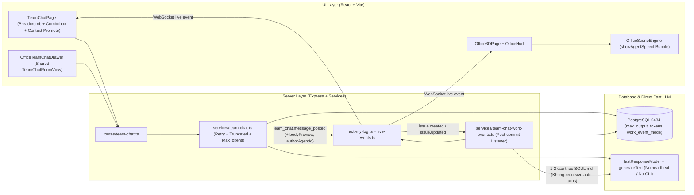

# Kế hoạch Triển khai: Team Chat Pha 1 → Pha 2 (Hoàn thiện Pha 1.5 + Kết nối Task + Tích hợp 3D Office)

## Goal Description

Pha 1 đã xây dựng xong nền tảng **Team Chat** độc lập (bảng `team_chat_rooms`, `team_chat_room_members`, `team_chat_room_messages`, gọi LLM nhẹ trực tiếp theo `SOUL.md` không kích hoạt `heartbeat`, giao diện `/team-chat` và luồng `Create Task`). Qua kiểm thử thực tế trên công ty `ptit`, kế hoạch này mở rộng từ Pha 1 lên **Pha 2** đồng thời bổ sung các chỉnh sửa UX/độ ổn định quan trọng theo **3 chặng kế tiếp nhau**:

1. **Pha 1.5 — Hoàn thiện & Ổn định Pha 1**:
   - **Tự gọi lại (auto-retry) khi câu trả lời bị cắt hoặc rỗng, và gắn nhãn `Truncated`**: nếu `finishReason === "length"` hoặc nội dung hiển thị rỗng, tự gọi lại đúng 1 lần với trần token gấp đôi (tối đa `4096`); nếu gọi lại vẫn chạm trần hoặc rỗng thì lưu tin với nhãn `Truncated` (`metadata.truncated = true`).
   - **Cấu hình `Max Output Tokens` theo từng phòng** (`128`–`4096`, mặc định `1024`) trong **Create Room** và **Room Settings**.
   - **Nâng cấp ô `Model Override` thành Popover Combobox có tìm kiếm** (`ModelCombobox.tsx`), thay thế `<datalist>` để hiển thị toàn bộ danh sách 470+ model ngay khi bấm, ghim nhóm model `:free` ổn định lên đầu và hỗ trợ nhập model tùy chỉnh.
   - **Sửa tiêu đề breadcrumb trên cùng từ `TASKS` thành `Team Chat`** (kèm tên kênh/DM đang mở) qua `useBreadcrumbs().setBreadcrumbs(...)`.
   - **Đưa đoạn hội thoại liên quan vào mô tả task khi bấm `Create Task`**: mặc định trích tối đa 8 tin nhắn gần nhất trước tin được chọn (mỗi dòng cắt gọn 320 ký tự), kèm checkbox bật/tắt `Include recent chat context (last 8 messages)`.
2. **Pha 2A — Tự động đăng tin giao việc & trạng thái (`Issue` → `Team Chat`)**:
   - Đăng ký service `team-chat-work-events.ts` lắng nghe `activity.logged` sau khi transaction DB đã commit (`subscribeAllCompanyLiveEvents`), không sửa logic transaction trong `issues.ts`.
   - Khi có `issue.created` (có `assigneeAgentId`, bỏ qua nguồn `team_chat.promote` để tránh trùng tin hệ thống) hoặc `issue.updated` (đổi người nhận `assigneeAgentId` hoặc `status` chuyển sang `done` / `in_review` / `blocked`), agent phù hợp đăng 1–2 câu đúng giọng `SOUL.md` kèm link issue vào phòng có `workEventMode = "assignments_and_status"`.
3. **Pha 2B — Tích hợp trực tiếp vào 3D Office (`Office3D` ↔ `Team Chat`)**:
   - Phát kèm `bodyPreview` (140 ký tự), `roomId`, `roomSlug`, `authorAgentId`, `linkedIssueId` trong `team_chat.message_posted` để frontend bắt event realtime.
   - Thêm `showAgentSpeechBubble(agentId, bubbleText, durationMs)` trong `OfficeSceneEngine` để hiện bong bóng hội thoại 3D ngay trên đầu nhân vật khi agent nhắn tin.
   - Tách `TeamChatRoomView.tsx` dùng chung và nhúng `OfficeTeamChatDrawer.tsx` vào màn hình 3D Office kèm nút bật/tắt + badge chưa đọc trên `OfficeHud`.

### Sơ đồ kiến trúc tổng quan



---

## User Review Required

> [!IMPORTANT]
> **Thay đổi Schema Database (Migration `0434`)**:
> Bổ sung 2 cột mới vào `team_chat_rooms`:
> - `max_output_tokens` (`integer`, `NOT NULL`, `DEFAULT 1024`)
> - `work_event_mode` (`text`, `NOT NULL`, `DEFAULT 'off'`, giá trị `'off' | 'assignments_and_status'`)
>
> Cả hai cột đều có `DEFAULT` an toàn, không ảnh hưởng dữ liệu các phòng hiện có (`#delivery-team`, `#watercooler`).

> [!IMPORTANT]
> **Tách biệt khỏi transaction của `issues.ts`**:
> Pha 2A chỉ subscribe `subscribeAllCompanyLiveEvents` sau khi transaction DB của issue đã commit (tương tự `unsubscribeChatCompletions` trong [server/src/index.ts](file:///c:/Users/OS/Desktop/paperclip/server/src/index.ts)). Tin nhắn cập nhật công việc tự động **không** kích hoạt `runAutoTurns` dây chuyền và **không** gọi `heartbeat`, đảm bảo không gây lặp vô hạn hoặc đụng chạm control-plane.

> [!WARNING]
> **Chi phí token khi bật Auto-Retry**:
> Khi model dừng vì `finishReason === "length"` hoặc trả về rỗng (thường xảy ra nếu `openrouter/free` rơi trúng model reasoning), hệ thống tự gọi lại **tối đa 1 lần** với mức trần `Math.min(Math.max(room.maxOutputTokens * 2, 1024), 4096)`. Lượt retry tiêu tốn thêm 1 request LLM; nếu vẫn cụt sẽ dừng và gắn nhãn `Truncated` chứ không retry tiếp.

---

## Open Questions

> [!IMPORTANT]
> Trước khi bắt đầu sửa code, nhờ bạn xác nhận 4 lựa chọn sau:
> 1. **Phạm vi thực thi**: Thực hiện trọn **cả 3 chặng (Pha 1.5 → Pha 2A → Pha 2B)** trong một lượt liên hoàn, hay làm trước **Pha 1.5** để bạn nghiệm thu rồi mới sang **Pha 2A + 2B**? *(Khuyến nghị: làm trọn **Pha 1.5 + 2A + 2B** tuần tự, kiểm thử đầy đủ sau mỗi lớp).*
> 2. **Số tin trích ngữ cảnh cho `Create Task`**: Mặc định **8 tin nhắn gần nhất** trước tin được chọn (mỗi dòng tối đa 320 ký tự, kèm checkbox tắt/bật trong modal) đã phù hợp với bạn chưa?
> 3. **Phạm vi phát tin công việc (Pha 2A) ở `ptit`**: Bật `workEventMode = "assignments_and_status"` riêng cho `#delivery-team` và giữ `#watercooler` ở `'off'` để kênh tán gẫu không bị lẫn thông báo task — bạn đồng ý chứ?
> 4. **Model mặc định cho 2 phòng mẫu `ptit`**: Có muốn cập nhật sẵn `#delivery-team` và `#watercooler` từ `openrouter/free` sang `google/gemma-4-26b-a4b-it:free` để phản hồi ổn định hơn không?

---

## Proposed Changes

### 1. Database & Shared Contracts (Nền tảng Pha 1.5 + Pha 2A)

Thứ tự phụ thuộc: cập nhật `packages/db` → sinh migration `0434` → cập nhật `packages/shared` → build cả 2 package trước khi sửa `server` và `ui`.

#### [MODIFY] [team_chat_rooms.ts](file:///c:/Users/OS/Desktop/paperclip/packages/db/src/schema/team_chat_rooms.ts)
Thêm 2 cột vào định nghĩa bảng `teamChatRooms`:
```ts
    maxAutoTurns: integer("max_auto_turns").notNull().default(4),
    maxOutputTokens: integer("max_output_tokens").notNull().default(1024),
    workEventMode: text("work_event_mode")
      .$type<"off" | "assignments_and_status">()
      .notNull()
      .default("off"),
```
Sau khi sửa, chạy `pnpm db:generate`, xác nhận chỉ giữ đúng 5 file `*_snapshot.json` mới nhất trong `packages/db/src/migrations/meta/`, và kiểm tra bằng `pnpm --filter @paperclipai/db check:migrations`.

#### [MODIFY] [team-chat.ts](file:///c:/Users/OS/Desktop/paperclip/packages/shared/src/validators/team-chat.ts)
- Bổ sung hằng số, kiểu và validator đồng bộ với DB:
```ts
export const TEAM_CHAT_MAX_OUTPUT_TOKENS_MIN = 128;
export const TEAM_CHAT_MAX_OUTPUT_TOKENS_MAX = 4096;
export const TEAM_CHAT_MAX_OUTPUT_TOKENS_DEFAULT = 1024;

export const TEAM_CHAT_WORK_EVENT_MODES = ["off", "assignments_and_status"] as const;
export type TeamChatWorkEventMode = (typeof TEAM_CHAT_WORK_EVENT_MODES)[number];

export interface TeamChatMessageMetadata extends Record<string, unknown> {
  turnIndex?: number;
  finishReason?: string;
  retried?: boolean;
  truncated?: boolean;
  origin?: "chat" | "work_event";
  workEventAction?: string;
  usage?: {
    inputTokens?: number | null;
    outputTokens?: number | null;
    costStatus?: string;
  };
}
```
- Thêm `maxOutputTokens` (`z.number().int().min(128).max(4096).optional()`) và `workEventMode` (`z.enum(TEAM_CHAT_WORK_EVENT_MODES).optional()`) vào `createTeamChatRoomSchema` và `updateTeamChatRoomSchema`.
- Bổ sung `maxOutputTokens: number` và `workEventMode: TeamChatWorkEventMode` vào `TeamChatRoomSummary`.

---

### 2. Pha 1.5 — Backend Service & Activity Metadata

#### [MODIFY] [team-chat.ts](file:///c:/Users/OS/Desktop/paperclip/server/src/services/team-chat.ts)
1. **Hỗ trợ `maxOutputTokens` & `workEventMode`** trong `hydrateRooms`, `createRoom`, `updateRoom`.
2. **Bảo vệ UUID đầu vào trong `requireRoomRow`**:
   ```ts
   if (!isUuidLike(roomId)) {
     throw notFound("Team chat room not found");
   }
   ```
   Tránh lỗi `500` từ Postgres khi nhận `roomId` sai định dạng UUID.
3. **Auto-retry khi câu trả lời bị cắt hoặc rỗng trong `defaultGenerateReply` & `runAutoTurns`**:
   - Dùng `room.maxOutputTokens` cho lần gọi `generateText` đầu tiên.
   - Kiểm tra `needsRetry = cleaned.length === 0 || result.finishReason === "length"`.
   - Nếu `needsRetry`, gọi lại đúng 1 lần với:
     - `retryMaxTokens = Math.min(Math.max(maxTokens * 2, 1024), TEAM_CHAT_MAX_OUTPUT_TOKENS_MAX)`
     - Nối thêm câu nhắc vào cuối `system` nếu lần đầu rỗng: `"Respond directly with visible conversational text immediately; do not spend tokens on hidden reasoning."`
   - Nếu sau retry vẫn `cleaned.length === 0 || finishReason === "length"`, đặt `truncated = true`, lưu `metadata: { turnIndex, finishReason, retried, truncated, usage }`. Nếu vẫn rỗng text, dùng thông báo ngắn có cấu trúc kèm đẩy cảnh báo vào mảng `warnings`.
4. **Phát kèm `bodyPreview` trong `logActivity` cho `team_chat.message_posted`**:
   ```ts
   await logActivity(db, {
     companyId: input.companyId,
     actorType: "agent",
     actorId: speaker.agentId,
     agentId: speaker.agentId,
     action: "team_chat.message_posted",
     entityType: "team_chat_room",
     entityId: input.room.id,
     details: {
       roomId: input.room.id,
       roomSlug: input.room.slug,
       messageId: inserted.id,
       authorType: "agent",
       authorAgentId: speaker.agentId,
       authorName: speaker.name,
       bodyPreview: reply.text.replace(/\s+/g, " ").trim().slice(0, 140),
       linkedIssueId: inserted.linkedIssueId ?? null,
       truncated: reply.truncated,
       provider: resolvedConn.provider,
       model: resolvedConn.model,
     },
   });
   ```

---

### 3. Pha 1.5 — UI Polish, Combobox, Breadcrumb & Promote Context

Tất cả component mới dưới `ui/src/pages/TeamChat/` bắt buộc tuân thủ rule `DESIGN.md` token-only (`node scripts/check-token-gates.mjs` phải `CLEAN`), không chỉnh `ui/src/i18n/locales/*.json`.

#### [NEW] [ModelCombobox.tsx](file:///c:/Users/OS/Desktop/paperclip/ui/src/pages/TeamChat/ModelCombobox.tsx)
- Dùng `Popover`, `PopoverTrigger`, `PopoverContent`, `Input`, `Button`, `Badge` có sẵn để thay `<input list="...">` + `<datalist>`.
- Bấm nút mở danh sách hiện ngay toàn bộ model tải từ API (`modelsQuery.data`) không bị lọc theo text hiện tại.
- Ô search bên trong popover lọc theo `id` / `label`; sắp xếp nhóm **Recommended Free / Fast** (đưa `:free` không có chữ `reasoning` như `gemma`, `flash`, `llama` lên trước `openrouter/free`) và nhóm **All Models**.
- Cho phép gõ và áp dụng model tùy chỉnh nếu không có trong danh sách.

#### [NEW] [teamChatHelpers.ts](file:///c:/Users/OS/Desktop/paperclip/ui/src/pages/TeamChat/teamChatHelpers.ts)
Tách logic thuần để test độc lập:
```ts
export const PROMOTE_CONTEXT_DEFAULT_COUNT = 8;
export const PROMOTE_CONTEXT_LINE_MAX_CHARS = 320;

export function isMessageTruncated(message: TeamChatMessage): boolean {
  return Boolean(message.metadata && message.metadata.truncated === true);
}

export function isWorkEventMessage(message: TeamChatMessage): boolean {
  return Boolean(message.metadata && message.metadata.origin === "work_event");
}

export function buildPromotedTaskDescription(
  messages: readonly TeamChatMessage[],
  targetMessage: TeamChatMessage,
  options: { roomLabel: string; includeContext: boolean; contextCount?: number },
): string {
  // Khi includeContext = false: chỉ trả về trích dẫn của targetMessage.
  // Khi includeContext = true: lấy tối đa contextCount (mặc định 8) tin trước targetMessage,
  // bỏ qua tin system trùng lặp, cắt gọn mỗi dòng 320 ký tự rồi ghép markdown gọn.
}
```

#### [NEW] [TeamChatRoomView.tsx](file:///c:/Users/OS/Desktop/paperclip/ui/src/pages/TeamChat/TeamChatRoomView.tsx)
Tách phần khung chat giữa (header phòng + banners + timeline có badge `Truncated` / `Work Update` + composer + Promote modal) khỏi `TeamChatPage.tsx` với prop `compact?: boolean`, `showHeaderActions?: boolean`:
- Trên từng tin nhắn bị cắt: hiển thị `<Badge variant="outline" className="text-xs border-destructive/40 text-destructive">` với text `Truncated`.
- Trong **Promote Message to Task** dialog: thêm checkbox `Include recent chat context (last 8 messages)` mặc định `true`, gọi `buildPromotedTaskDescription` điền vào `Task Description` (vẫn sửa tự do trước khi bấm **Create task**).

#### [MODIFY] [teamChatCopy.ts](file:///c:/Users/OS/Desktop/paperclip/ui/src/pages/TeamChat/teamChatCopy.ts)
Bổ sung key cho `Truncated`, `Work Update`, `Max Output Tokens`, `Auto Work Updates`, `Include recent chat context (last 8 messages)` và label của `ModelCombobox`.

#### [MODIFY] [TeamChatPage.tsx](file:///c:/Users/OS/Desktop/paperclip/ui/src/pages/TeamChat/TeamChatPage.tsx)
1. **Breadcrumb `Team Chat`**:
   ```tsx
   const { setBreadcrumbs } = useBreadcrumbs();
   useEffect(() => {
     if (activeRoom) {
       const roomLabel = activeRoom.kind === "channel" ? `#${activeRoom.slug}` : activeRoom.name;
       setBreadcrumbs([
         { label: copy("teamChat.title"), href: "/team-chat" },
         { label: roomLabel },
       ]);
     } else {
       setBreadcrumbs([{ label: copy("teamChat.title") }]);
     }
   }, [activeRoom, copy, setBreadcrumbs]);
   ```
2. Sử dụng `<TeamChatRoomView />` cho khung giữa và dùng `<ModelCombobox />` + ô `Max Output Tokens` (`128`–`4096`) + select `Auto Work Updates` trong cả 2 modal **Create Room** và **Room Settings**.

---

### 4. Pha 2A — Tự động đăng tin công việc (`Issue` → `Team Chat`)

#### [NEW] [team-chat-work-events.ts](file:///c:/Users/OS/Desktop/paperclip/server/src/services/team-chat-work-events.ts)
Service `teamChatWorkEventService(db, options?)` xử lý post-commit `LiveEvent`:
1. Lọc `event.type === "activity.logged"` với `event.payload.entityType === "issue"`.
2. Phân loại sự kiện cần phát:
   - `issue.created` có `assigneeAgentId` và `details.source !== "team_chat.promote"`.
   - `issue.updated` có `details.changes.assigneeAgentId` khác `_previous.assigneeAgentId` (handoff), HOẶC `details.changes.status` chuyển sang `"done" | "in_review" | "blocked"`.
3. Chống spam: Map dedup trong RAM theo key `${roomId}:${issueId}:${kind}:${value}` với TTL 60 giây.
4. Tìm tất cả phòng chưa archive trong `event.companyId` có `workEventMode = "assignments_and_status"` mà `speakerAgentId` (hoặc `assigneeAgentId`) là thành viên.
5. Tạo câu thoại cá nhân hoá ngắn (1–2 câu đúng chất `SOUL.md`, tối đa `Math.min(room.maxOutputTokens, 512)` token, nhắc chính xác mã issue ví dụ `PTI-12`), fallback về câu mẫu có cấu trúc nếu connection chưa sẵn sàng hoặc lỗi LLM.
6. Insert tin `authorType: "agent"`, `linkedIssueId: issue.id`, `metadata: { origin: "work_event", workEventAction }`, cập nhật `updatedAt`, gọi `logActivity` với `action: "team_chat.message_posted"` + `bodyPreview`. **Tuyệt đối không gọi `runAutoTurns` đệ quy và không gọi `heartbeat`.**

#### [MODIFY] [index.ts](file:///c:/Users/OS/Desktop/paperclip/server/src/index.ts)
Đăng ký subscriber ngay sau `unsubscribeChatCompletions` (khoảng dòng 1375) và dọn dẹp qua `server.on("close", unsubscribeTeamChatWorkEvents)`.

---

### 5. Pha 2B — Tích hợp 3D Office (`Office3D` ↔ `Team Chat`)

#### [MODIFY] [OfficeSceneEngine.ts](file:///c:/Users/OS/Desktop/paperclip/ui/src/pages/Office3D/scene/OfficeSceneEngine.ts)
Thêm helper công khai tái sử dụng cơ chế `actor.bubbleText` & `actor.bubbleExpiresAtMs`:
```ts
showAgentSpeechBubble(agentId: string, bubbleText: string, durationMs = 9000): void {
  const actor = this.agentActors.get(agentId);
  if (!actor) return;
  const normalized = bubbleText.replace(/\s+/g, " ").trim();
  if (!normalized) return;
  const nowMs = performance.now();
  actor.bubbleText = normalized.length > 96 ? `${normalized.slice(0, 93)}...` : normalized;
  actor.bubbleExpiresAtMs = nowMs + durationMs;
}
```

#### [NEW] [OfficeTeamChatDrawer.tsx](file:///c:/Users/OS/Desktop/paperclip/ui/src/pages/Office3D/components/OfficeTeamChatDrawer.tsx)
Drawer cạnh phải tương tự `OfficeChatDrawer.tsx` & `OfficePlaybookDrawer.tsx`:
- Dropdown / tab chuyển nhanh giữa các phòng của công ty, nút mở toàn trang `/team-chat/:roomId` và nút đóng `X`.
- Nhúng `<TeamChatRoomView compact showHeaderActions={false} />` hỗ trợ chat, `@mention`, `Let Team Discuss` và `Create Task` ngay trên không gian 3D Office.

#### [MODIFY] [OfficeHud.tsx](file:///c:/Users/OS/Desktop/paperclip/ui/src/pages/Office3D/components/OfficeHud.tsx)
#### [MODIFY] [officeCopy.ts](file:///c:/Users/OS/Desktop/paperclip/ui/src/pages/Office3D/officeCopy.ts)
#### [MODIFY] [Office3DPage.tsx](file:///c:/Users/OS/Desktop/paperclip/ui/src/pages/Office3D/Office3DPage.tsx)
- Thêm nút **Team Chat** (`MessagesSquare`) + huy hiệu số tin chưa đọc lên `OfficeHud`.
- Trong `Office3DPage.tsx`:
  - Quản lý `teamChatDrawerOpen` và `unreadTeamChatCount` (mở drawer Team Chat tự đóng `chatDrawerAgentId` / `playbookDrawerState` để không chồng drawer).
  - Lắng nghe `useCompanyLiveEvent`: khi nhận `activity.logged` với `action === "team_chat.message_posted"` có `details.authorAgentId` & `details.bodyPreview`:
    - Gọi `engineRef.current?.showAgentSpeechBubble(authorAgentId, bodyPreview, 9000)`.
    - Nếu drawer đang đóng thì tăng `unreadTeamChatCount`.

---

## Verification Plan

### Automated Tests

1. **DB Schema, Migration & Shared Build**:
   ```powershell
   pnpm db:generate
   Get-ChildItem packages/db/src/migrations/meta/*_snapshot.json | Select-Object -ExpandProperty Name
   pnpm --filter @paperclipai/db build; if ($LASTEXITCODE -eq 0) { pnpm --filter @paperclipai/db check:migrations }
   pnpm --filter @paperclipai/shared build
   ```
   Kỳ vọng: sinh `0434_*.sql`, giữ đúng 5 file snapshot (`0430`–`0434`), `check:migrations` và build đều thoát `0`.

2. **Design System Token Gates**:
   ```powershell
   node scripts/check-token-gates.mjs
   ```
   Kỳ vọng: 4/4 gate báo **CLEAN** (0 vi phạm hex, px, arbitrary bracket, fontSize).

3. **TypeScript Typecheck**:
   ```powershell
   pnpm --filter @paperclipai/server typecheck; if ($LASTEXITCODE -eq 0) { pnpm --filter @paperclipai/ui typecheck }
   ```
   Kỳ vọng: exit `0` trên cả `server` và `ui`.

4. **Vitest Unit, Route & UI Component Tests**:
   - Cập nhật [team-chat-routes.test.ts](file:///c:/Users/OS/Desktop/paperclip/server/src/__tests__/team-chat-routes.test.ts): validation `maxOutputTokens` (`128`–`4096`), `workEventMode`, auto-retry 1 lần khi `finishReason === "length"` hoặc rỗng, đánh dấu `truncated: true`, `404` cho non-UUID `roomId`.
   - Thêm `[NEW] server/src/__tests__/team-chat-work-events.test.ts`: kiểm thử sự kiện `issue.created` / `issue.updated` (giao việc, hoàn thành, bị chặn), dedup 60s, lọc phòng `workEventMode = "off"`, fallback khi thiếu AI connection, và bảo đảm không kích hoạt `runAutoTurns` hay `heartbeat`.
   - Cập nhật [TeamChatPage.test.tsx](file:///c:/Users/OS/Desktop/paperclip/ui/src/pages/TeamChat/TeamChatPage.test.tsx): breadcrumb `Team Chat`, nhãn `Truncated`, `ModelCombobox` hiện đủ model và tìm kiếm được, cài đặt `Max Output Tokens`, và `buildPromotedTaskDescription` kèm/không kèm 8 tin ngữ cảnh.
   - Cập nhật [Office3DPage.test.tsx](file:///c:/Users/OS/Desktop/paperclip/ui/src/pages/Office3D/Office3DPage.test.tsx): mở `OfficeTeamChatDrawer` từ HUD và bắn `showAgentSpeechBubble` khi nhận event `team_chat.message_posted`.
   - Lệnh chạy:
     ```powershell
     pnpm vitest run server/src/__tests__/team-chat-routes.test.ts server/src/__tests__/team-chat-work-events.test.ts ui/src/pages/TeamChat ui/src/pages/Office3D ui/src/lib/company-routes.test.ts
     ```

5. **UI Production Build**:
   ```powershell
   pnpm --filter @paperclipai/ui build
   ```

### Manual Verification (Live trên `http://localhost:3100`, công ty `ptit`)

1. Restart server local để áp dụng migration `0434`, xác nhận `GET /api/health` trả về `status: "ok"`.
2. Trên http://localhost:3100/PTI/team-chat:
   - Thanh breadcrumb trên cùng hiển thị **Team Chat / #delivery-team** (không còn `TASKS`).
   - Mở **Room Settings** → click **Model Override** kiểm tra popover xổ ra toàn bộ model ngay lập tức và gõ tìm `:free` mượt; thử chỉnh `Max Output Tokens` và bật **Auto Work Updates**.
   - Nếu mô phỏng trần thấp (ví dụ `128`), xác nhận tin thử nghiệm tự retry hoặc hiện rõ nhãn `Truncated`.
   - Bấm **Create Task** trên một tin nhắn → xác nhận ô mô tả có sẵn `Selected Message` + `Recent Discussion Context` (tối đa 8 tin) và có checkbox bật/tắt.
3. Kiểm chứng Pha 2A: tạo hoặc cập nhật 1 issue giao cho agent trong `#delivery-team` (hoặc đổi trạng thái sang `done`) → xác nhận 1 tin `Work Update` theo giọng `SOUL.md` kèm link issue tự đăng vào `#delivery-team` và không sinh thêm heartbeat run mới.
4. Trên http://localhost:3100/PTI/office:
   - Mở nút **Team Chat** trên thanh công cụ HUD, gửi tin tag `@cuong` → xác nhận nhân vật `cuong` trong văn phòng 3D hiện **bong bóng hội thoại** trên đầu đồng thời nội dung cập nhật trong drawer.
