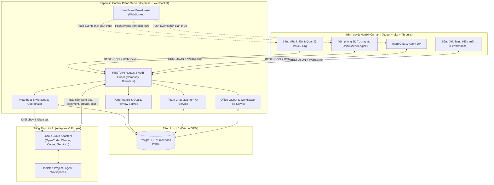
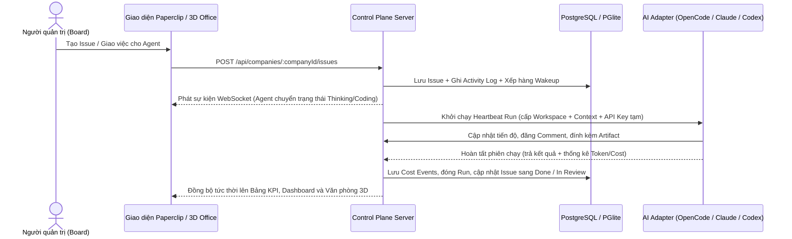
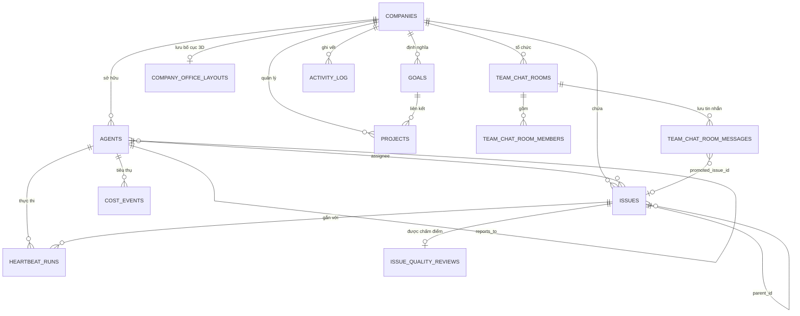

# BÁO CÁO ĐỒ ÁN / BÀI TẬP LỚN
## Môn học: Quản lý Dự án Phần mềm / Công nghệ Phần mềm
### Đề tài: Xây dựng và Mở rộng Nền tảng Điều phối Công ty AI Tự hành Paperclip tích hợp Văn phòng Ảo 3D, Giao tiếp Đa Agent và Đo lường Hiệu suất KPI

**Sinh viên / Nhóm thực hiện:** .............................................................  
**Mã sinh viên:** .............................................................  
**Lớp:** .............................................................  
**Giảng viên hướng dẫn:** .............................................................  
**Hà Nội – Năm 2026**

---

## MỤC LỤC

1. [Lời mở đầu](#lời-mở-đầu)
2. [Chương 1. Tổng quan đề tài và Bài toán nghiệp vụ](#chương-1-tổng-quan-đề-tài-và-bài-toán-nghiệp-vụ)
3. [Chương 2. Kiến trúc tổng thể và Công nghệ sử dụng](#chương-2-kiến-trúc-tổng-thể-và-công-nghệ-sử-dụng)
4. [Chương 3. Phân tích và Thiết kế các Phân hệ Chức năng](#chương-3-phân-tích-và-thiết-kế-các-phân-hệ-chức-năng)
5. [Chương 4. Thiết kế Cơ sở dữ liệu và Hệ thống API](#chương-4-thiết-kế-cơ-sở-dữ-liệu-và-hệ-thống-api)
6. [Chương 5. Cài đặt, Vận hành và Kiểm thử](#chương-5-cài-đặt-vận-hành-và-kiểm-thử)
7. [Chương 6. Đánh giá Kết quả và Hướng phát triển](#chương-6-đánh-giá-kết-quả-và-hướng-phát-triển)
8. [Kết luận](#kết-luận)
9. [Tài liệu tham khảo](#tài-liệu-tham-khảo)

---

## LỜI MỞ ĐẦU

Sự bùng nổ của các mô hình ngôn ngữ lớn (LLM) và các tác nhân lập trình tự động (AI Coding Agents) đã chuyển dịch cách phát triển phần mềm từ mô hình *"một người dùng trò chuyện với một chatbot"* sang mô hình *"tổ chức gồm nhiều chuyên gia AI phối hợp thực hiện dự án"*. Tuy nhiên, khi quy mô đội ngũ AI tăng lên (gồm CEO điều phối, Quản lý dự án PM, Kỹ sư Full-Stack, Kỹ sư QA, DevOps, Thiết kế UI/UX...), các công cụ quản lý tác vụ truyền thống bộc lộ nhiều khoảng trống: thiếu cơ chế khóa nhận việc nguyên tử (atomic checkout), thiếu kiểm soát ngân sách token theo thời gian thực, thiếu quy trình nghiệm thu – yêu cầu sửa lại tự động, và đặc biệt là thiếu một không gian trực quan để con người nắm bắt tức thời toàn cảnh hoạt động của công ty AI.

Dự án **Paperclip** được xây dựng nhằm giải quyết trọn vẹn bài toán trên với vai trò là **Mặt phẳng điều khiển (Control Plane) cho các công ty AI tự hành**. Trên nền tảng điều phối cốt lõi của Paperclip, dự án đã thiết kế và tích hợp trực tiếp ba phân hệ mở rộng trọng tâm ngay trong cùng một ứng dụng thống nhất:

1. **Văn phòng ảo 3D tương tác thời gian thực (`Office3D`)**: Trực quan hóa toàn bộ sơ đồ tổ chức, tòa nhà đa tầng, trạng thái làm việc, họp Standup, tuyển dụng, duyệt mã nguồn và bảng chỉ số KPI ngay trong không gian 3D Voxel dựa trên Three.js.
2. **Hệ thống Giao tiếp Nhóm & Nhắn tin Trực tiếp (`Team Chat & Agent DM`)**: Cho phép người vận hành thảo luận nhóm nhiều lượt với nhiều AI Agent cùng lúc, nhắn riêng 1-1 và chuyển đổi thảo luận thành công việc thực tế.
3. **Hệ thống Đo lường Hiệu suất & Nghiệm thu Chất lượng (`Agent Performance & Board Quality Review`)**: Định lượng chất lượng làm việc của từng Agent bằng điểm số tổng hợp (`Score 0–100`), theo dõi tỷ lệ làm lại (`Reopen Rate`), chi phí/nhiệm vụ và tự động hóa quy trình đánh thức Agent sửa lỗi (`Auto-Rework`).

---

## CHƯƠNG 1. TỔNG QUAN ĐỀ TÀI VÀ BÀI TOÁN NGHIỆP VỤ

### 1.1. Bài toán đặt ra

Khi vận hành một tổ chức gồm nhiều AI Agent cùng tham gia phát triển sản phẩm, người quản trị (Board Operator) cần trả lời chính xác 5 câu hỏi ở mọi thời điểm:
- **Ai đang làm việc gì, phục vụ mục tiêu nào?** (Truy vết từ nhiệm vụ con về mục tiêu cấp công ty).
- **Quá trình thực thi có an toàn và không xung đột không?** (Đảm bảo hai phiên chạy không giẫm chân lên cùng một task hoặc ghi đè workspace).
- **Chi phí vận hành hết bao nhiêu và có vượt ngưỡng cho phép không?** (Theo dõi token, cache hit, ngân sách tháng và tự động tạm dừng khi chạm trần).
- **Chất lượng đầu ra của từng Agent ra sao?** (Đo lường tỷ lệ chạy thành công, số lần phải mở lại task để làm lại và điểm chấm từ người duyệt).
- **Làm sao quan sát và tương tác tự nhiên với cả đội ngũ?** (Thay vì phải mở hàng chục trang log rời rạc, người vận hành có thể quan sát trực tiếp trong văn phòng ảo 3D).

### 1.2. Sự tiến hóa từ mô hình tách rời sang nền tảng hợp nhất

Ở giai đoạn khảo sát ban đầu, hệ thống gồm hai ứng dụng chạy tách biệt: **Paperclip** (quản trị backend/UI ở cổng `3100`) và **Claw3D** (ứng dụng Next.js riêng ở cổng `3000` kết nối qua cầu nối WebSocket). Mô hình tách rời này tồn tại hạn chế về đồng bộ trạng thái (hai nguồn lưu trữ cấu hình riêng), tốn tài nguyên chạy song song hai server và thiếu gắn kết sâu với hệ thống đánh giá KPI hay hội thoại nội bộ.

Trong phiên bản hoàn thiện hiện tại, toàn bộ không gian **3D Office**, **Team Chat** và **Performance Analytics** đã được thiết kế và tích hợp **nguyên bản (native)** trực tiếp vào kiến trúc Monorepo của Paperclip:
- Dùng chung **một cơ sở dữ liệu PostgreSQL / PGlite duy nhất** và một cổng dịch vụ duy nhất (`http://localhost:3100`).
- Chia sẻ chung hệ thống phân quyền theo công ty (`company-scoped`), luồng sự kiện thời gian thực WebSocket (`LiveUpdatesProvider`) và bộ quy chuẩn giao diện Design Tokens.

### 1.3. Phạm vi hệ thống

- **`packages/db`**: Định nghĩa lược đồ dữ liệu (Drizzle ORM) và quản lý migration cho toàn bộ thực thể công ty, nhân sự AI, công việc, phiên chạy, ngân sách, bố cục văn phòng 3D, phòng chat và đánh giá chất lượng.
- **`packages/shared`**: Định nghĩa hợp đồng dữ liệu dùng chung (TypeScript types, hằng số, bộ kiểm tra hợp lệ Zod schemas).
- **`server`**: REST API (Express) và tầng dịch vụ điều phối Heartbeat, Workspace, Performance, Team Chat, Office Layout, Activity Audit.
- **`packages/adapters` & `packages/paperclip-runner`**: Bộ kết nối đa môi trường thực thi AI (`opencode_local`, `claude_local`, `codex_local`, `gemini_local`, `cursor`, `pi_local`, HTTP/Process, OpenClaw).
- **`ui`**: Ứng dụng quản trị React + Vite + Three.js Voxel Engine.
- **`cli`**: Công cụ dòng lệnh `paperclipai` dành cho cả lập trình viên và AI Agent tự gọi khi thực thi nhiệm vụ.

---

## CHƯƠNG 2. KIẾN TRÚC TỔNG THỂ VÀ CÔNG NGHỆ SỬ DỤNG

### 2.1. Tổ hợp công nghệ (Tech Stack)

| Tầng kiến trúc | Công nghệ chủ đạo | Vai trò trong dự án |
|---|---|---|
| **Frontend UI** | React 19, Vite, TypeScript, TanStack Query | Giao diện điều hành, đồng bộ cache trạng thái và định tuyến đa công ty |
| **Đồ họa 3D** | Three.js (WebGL2, InstancedMesh, CanvasTexture) | Dựng cảnh văn phòng Voxel đa tầng, nhân vật, thời tiết, ánh sáng và bảng KPI động |
| **Hệ thống giao diện** | Tailwind CSS, Radix UI, CSS Custom Tokens | Đảm bảo nhất quán giao diện sáng/tối, kiểm soát tự động bằng `check-token-gates` |
| **Backend API** | Node.js, Express, TypeScript, WebSocket (`ws`) | Cung cấp RESTful API, xác thực quyền Board/Agent và phát sự kiện thời gian thực |
| **Cơ sở dữ liệu** | PostgreSQL / Embedded PGlite, Drizzle ORM | Lưu trữ bền vững toàn bộ trạng thái; tự động chạy DB nhúng khi phát triển cục bộ |
| **Xác thực dữ liệu** | Zod (`@paperclipai/shared`) | Kiểm tra hợp lệ đầu vào/đầu ra đồng nhất giữa UI, Server và CLI |
| **AI Runtime Adapters** | OpenCode, Claude Code, Codex, Gemini, Cursor, ACP | Khởi chạy, giám sát, thu thập chi phí token và dừng an toàn các tiến trình AI |
| **Kiểm thử & Đảm bảo CL** | Vitest, JSDOM, Playwright, TypeScript Compiler | Kiểm thử đơn vị, kiểm thử tích hợp giao diện và kiểm thử đầu-cuối trên trình duyệt |

### 2.2. Sơ đồ kiến trúc tổng thể



### 2.3. Các bất biến kỹ thuật cốt lõi (Control-Plane Invariants)

1. **Cô lập dữ liệu theo công ty (`Company-Scoped Multi-Tenancy`)**: Mọi bảng nghiệp vụ đều gắn khóa ngoại `company_id`. API kiểm tra quyền truy cập công ty ở mọi truy vấn và thao tác ghi; khóa API của Agent thuộc công ty nào chỉ được phép thao tác trong phạm vi công ty đó.
2. **Một người phụ trách & Khóa nhận việc nguyên tử (`Single-Assignee & Atomic Checkout`)**: Mỗi nhiệm vụ (`Issue`) tại một thời điểm chỉ có một người phụ trách và được khóa nguyên tử khi bắt đầu phiên chạy, ngăn chặn hoàn toàn tình trạng hai Agent xử lý trùng lặp.
3. **Đồng bộ hợp đồng 4 lớp (`4-Layer Contract Sync`)**: Mọi thay đổi dữ liệu đều đi xuyên suốt `packages/db` -> `packages/shared` -> `server` -> `ui`.
4. **Cổng kiểm soát giao diện tự động (`Design Token Gates`)**: Toàn bộ màu sắc, kích thước chữ và khoảng cách trong giao diện tuân thủ hệ thống biến CSS ngữ nghĩa, được kiểm tra tự động qua công cụ `scripts/check-token-gates.mjs`.

---

## CHƯƠNG 3. PHÂN TÍCH VÀ THIẾT KẾ CÁC PHÂN HỆ CHỨC NĂNG

### 3.1. Phân hệ Lõi Điều phối Công ty AI (Control Plane Core)

- **Cây mục tiêu và công việc phân cấp (`Goal -> Project -> Parent Issue -> Sub-issue`)**: Mọi nhiệm vụ nhỏ đều liên kết ngược lên mục tiêu chiến lược của công ty, giúp AI Agent luôn nắm được ngữ cảnh *"tại sao mình cần thực hiện công việc này"*.
- **Sơ đồ tổ chức (`Org Chart`)**: Nhân sự AI được phân vai trò (`ceo`, `cto`, `pm`, `engineer`, `qa`, `designer`, `devops`, `researcher`...) và liên kết quản lý qua trường `reports_to`.
- **Điều phối nhịp tim (`Heartbeat Lifecycle`)**: Mỗi khi có nhiệm vụ mới được giao, đến lịch định kỳ (`Routine`), hoặc có yêu cầu sửa lỗi (`Rework`), bộ điều phối đánh thức Agent dậy thực thi trong thư mục làm việc được cấp, ghi nhận chi tiết nhật ký chạy (`heartbeat_run_events`), chi phí token (`cost_events`) và sản phẩm bàn giao (`artifacts`).
- **Kiểm soát ngân sách & Cổng phê duyệt (`Budget Hard-Stop & Approval Gates`)**: Cho phép đặt hạn mức chi tiêu cho công ty hoặc từng Agent; tự động tạm dừng khi chạm trần ngân sách; các hành động nhạy cảm như tuyển thêm Agent có thể yêu cầu người quản trị phê duyệt.



---

### 3.2. Phân hệ Văn phòng Ảo 3D Tương tác (`Office3D` — `/:companyPrefix/office`)

Phân hệ `Office3D` (`ui/src/pages/Office3D/`) biến toàn bộ dữ liệu trừu tượng của Control Plane thành một tòa nhà văn phòng 3D sống động, nơi người vận hành vừa có thể quan sát trực quan vừa có thể điều hành công việc trực tiếp.

#### 3.2.1. Kiến trúc tòa nhà đa tầng & Thang máy hai chiều
- Hỗ trợ **nhiều tòa nhà (`Buildings`)** và **nhiều tầng (`Floors`)** với hai chế độ quan sát kiến trúc: **Mặt cắt (`Cutaway`)** dễ quan sát nội thất bên trong và **Toàn khối tòa nhà (`Full Building`)** có mái, kính mặt dựng và ban công.
- **Di chuyển xuyên tầng bằng thang máy tự động**: Khi gọi họp (`Call Meeting`) hoặc khi có bàn giao công việc xuyên tầng (`Handoff`), các Agent từ Tầng 2 tự động đi bộ vào buồng thang máy trượt cửa xuống Tầng 1 dự họp / trao đổi, sau đó đi thang máy trở về lại tầng của mình.

#### 3.2.2. Hệ thống điều khiển nhân vật & Camera đa góc nhìn
- **3 chế độ Camera**:
  1. **`RPG Mode`**: Góc nhìn thứ ba bám theo nhân vật người chơi.
  2. **`First-Person Mode` (Góc nhìn thứ nhất kiểu Minecraft)**: Hỗ trợ khóa tâm chuột giữa màn hình (`Pointer Lock`), hiển thị tay cầm vật phẩm 3D và tương tác trực tiếp bằng tâm ngắm.
  3. **`Overview Mode` + `Minimap`**: Góc nhìn toàn cảnh từ trên cao kết hợp bản đồ thu nhỏ cho phép click dịch chuyển nhanh.
- **Chuyển động & Tương tác xã hội**: Di chuyển `WASD`, chạy nhanh (`Shift`), nhảy (`Space`), mở thanh biểu cảm (`G` — Vẫy tay `Wave` khiến các Agent đang rảnh gần đó vẫy tay chào lại, Ăn mừng `Celebrate`, Vỗ tay `Clap`, Vươn vai `Stretch`).
- **Thanh vật phẩm `Hotbar 6 ô`**: Người chơi có thể lấy cốc nước, tách cà phê, sổ tay hoặc hồ sơ Issue từ bàn làm việc; nhấn `F` hoặc `E` để mở đọc toàn bộ nội dung chi tiết Issue đang cầm trên tay, hoặc trao trực tiếp cho Agent đứng gần.
- **Chế độ `Follow Agent`**: Khóa camera trượt mượt theo chân bất kỳ Agent nào (tự động chuyển đúng tầng của Agent đó) để quan sát công việc thực tế.
- **Ghi nhớ vị trí thông minh**: Tự động lưu và khôi phục chính xác tòa nhà, tầng, tọa độ `(x, z)` và góc nhìn của người chơi theo từng công ty khi chuyển sang trang khác rồi quay lại.

#### 3.2.3. Nghiệp vụ điều hành trực tiếp bên trong không gian 3D
- **Họp `Standup Meeting` có hội thoại theo lượt**: Khi kích hoạt tại bàn họp hoặc menu tùy chọn, các Agent tập hợp quanh bàn họp và lần lượt phát biểu mỗi `4.8 giây` dựa trên nhiệm vụ thực tế đang đảm nhận (`currentIssueIdentifier`) hoặc phương châm làm việc (`slogan`), trong khi đồng nghiệp vỗ tay hưởng ứng.
- **Màn hình `Live Company KPI Screen` 3D**: Bảng điện tử dựng bằng `CanvasTexture` cập nhật trực tiếp theo thời gian thực các chỉ số `DONE`, `ACTIVE`, `AGENTS (đang chạy/tổng số)`, `SPEND (chi phí trong ngày)` và vinh danh **`TOP: <Tên Agent> (<Score>)`** lấy từ điểm hiệu suất 30 ngày cao nhất.
- **Tuyển dụng trực tiếp tại Quầy Lễ tân HR (`Hire Agent in Office`) & Thuật toán xếp bàn thông minh**:
  - Tuyển mới Agent ngay trong văn phòng mà không cần rời cảnh 3D.
  - Thuật toán `autoPlaceDeskInBuilding` tự động ưu tiên xếp bàn vào đúng phòng của người quản lý trực tiếp (`reportsTo`) hoặc đồng nghiệp cùng nhóm, tránh phòng họp và phòng riêng của CEO, kiểm tra đầy đủ diện tích bàn + ghế ngồi + lối đi để không bao giờ đè lên đồ trang trí sẵn có; nếu phòng đầy tự chuyển sang phòng kế tiếp, và nếu toàn bộ các tầng đều kín chỗ sẽ tự động xây thêm tầng mới (`Studio Wing`).
- **Quy hoạch mặt bằng tự động theo sơ đồ tổ chức (`Re-layout from Org`)**: Tính toán sức chứa bàn thực tế của từng kích thước phòng (`computeRoomDeskCapacity`), tự động tách phòng khi nhóm đông và tự chồng thêm tầng mới khi vượt sức chứa của tầng dưới.
- **Chế độ Xây dựng (`Build Office`)**: Cho phép kéo dựng phòng kính/gỗ, đặt cửa, kê bàn, bố trí nội thất làm việc, khu giải trí và cây cối sân vườn; hỗ trợ `Undo/Redo`, xoay hướng `90°`, xuất/nhập bản vẽ `Blueprint JSON` và lưu đồng bộ lên cơ sở dữ liệu (`company_office_layouts`).
- **Duyệt mã nguồn tại Tủ `Server Rack` & Chỉnh sửa `AGENTS.md`**: Mở cây thư mục và đọc mã nguồn thực tế trong workspace của dự án/Agent ngay trong văn phòng; chỉnh sửa bộ tài liệu hướng dẫn đa tệp (`Playbook Drawer`).
- **Môi trường tự nhiên & Giải trí**: Chu kỳ ánh sáng thời gian thực (Ngày / Hoàng hôn / Đêm tự bật đèn), hiệu ứng Mưa / Tuyết, cánh hoa anh đào rơi ban ngày & đom đóm phát sáng ban đêm, sân vườn có thú cưng tương tác (Chó đi theo người chơi, Mèo, Thỏ, Hồ cá Koi cho ăn, Đài phun nước) và máy điện tử chơi được thật **`Retro Arcade — Voxel Snake`** có lưu điểm kỷ lục (`High Score`).

---

### 3.3. Phân hệ Giao tiếp Nhóm & Trực tiếp với AI (`Team Chat`)

Phân hệ `Team Chat` (`/:companyPrefix/team-chat` và ngăn kéo `Team Chat` ngay trong 3D Office) cung cấp môi trường trao đổi tập trung theo phòng ban và nhắn tin riêng 1-1 (`DM`):
- **Phòng thảo luận đa Agent (`Channels`) & Tin nhắn riêng (`Direct Messages`)**: Người dùng có thể tạo kênh theo chủ đề, chọn các Agent thành viên tham gia.
- **Thảo luận nhóm tự động nhiều lượt (`Multi-turn AI Discussion`)**: Khi người dùng đặt vấn đề hoặc bấm thảo luận, các Agent trong phòng lần lượt phản hồi dựa trên vai trò chuyên môn và ngữ cảnh dự án (giới hạn an toàn qua `max_auto_turns`).
- **Chuyển đổi tin nhắn thành công việc (`Promote Message to Issue`)**: Bất kỳ ý tưởng hay kết luận nào trong cuộc trò chuyện đều có thể chuyển thành một Issue chính thức trên Paperclip chỉ với một cú nhấp chuột.
- **Đồng bộ trực quan với Văn phòng 3D**: Khi một Agent gửi tin nhắn trong Team Chat, sự kiện `team_chat.message_posted` được đẩy qua WebSocket giúp nhân vật 3D của Agent đó hiện ngay bong bóng lời thoại tương ứng trên đầu.

---

### 3.4. Phân hệ Đo lường Hiệu suất & Đánh giá Chất lượng (`Performance` & `Board Quality Review`)

Để quản trị chất lượng đầu ra của nhân sự AI một cách khách quan, phân hệ `Performance` (`/:companyPrefix/performance` và dịch vụ `server/src/services/performance.ts`) tổng hợp dữ liệu theo các khung thời gian `7 ngày`, `30 ngày` và `Toàn thời gian`:

#### 3.4.1. Các chỉ số đo lường chính
- **`Tasks Done`**: Số lượng công việc hoàn thành trên tổng số việc được giao.
- **`Run Success Rate (%)`**: Tỷ lệ phiên chạy Heartbeat hoàn tất thành công không gặp lỗi/timeout.
- **`Reopen Rate (%)`**: Tỷ lệ công việc đã đóng `done` nhưng phải mở lại để làm lại (phát hiện tự động từ lịch sử chuyển trạng thái trong `activity_log`).
- **`Avg Cycle Time` & `Avg Run Duration`**: Thời gian trung bình hoàn thành một nhiệm vụ và thời lượng trung bình mỗi phiên chạy.
- **`Prompt Cache Hit Rate (%)` & `Cost / Task (USD)`**: Đánh giá hiệu quả tối ưu hóa chi phí token của từng Agent.
- **`Board Rating (1–5★)`**: Điểm đánh giá nghiệm thu trực tiếp của người quản trị trên từng kết quả công việc.

#### 3.4.2. Công thức tính Điểm hiệu suất tổng hợp (`Performance Score` 0–100)

Điểm hiệu suất của mỗi Agent được tính theo trung bình trọng số chuẩn hóa:

$$\text{Score} = \text{round}\left(\frac{0.45 \times \text{RunSuccess} + 0.25 \times (100 - \text{ReopenRate}) + 0.30 \times \left(\frac{\text{BoardRating}}{5} \times 100\right)}{\sum W_{\text{có dữ liệu}}}\right)$$

Trong đó hệ thống tự động chuẩn hóa mẫu số theo tổng trọng số của các thành phần đã có dữ liệu (ví dụ khi Agent mới hoàn thành công việc nhưng người quản trị chưa chấm sao, điểm vẫn phản ánh công bằng dựa trên tỷ lệ chạy thành công `0.45` và tỷ lệ không phải làm lại `0.25`, không bị phạt 0 điểm oan).

#### 3.4.3. Vòng lặp Nghiệm thu & Yêu cầu Sửa lại tự động (`Closed-Loop Rework`)
Trên giao diện chi tiết mỗi Issue hoàn thành có thẻ **`Board Quality Review`**:
- Nếu đạt yêu cầu: Người duyệt chấm `4–5★` kèm trạng thái **`Pass`**.
- Nếu chưa đạt yêu cầu: Người duyệt chọn **`Needs Rework`**, ghi chú lỗi cần sửa và bật tùy chọn mở lại công việc. Hệ thống lập tức thực hiện chuỗi 3 tác vụ tự động:
  1. Lưu đánh giá vào bảng `issue_quality_reviews` và chuyển trạng thái Issue từ `done` về `todo` (ghi nhận vào chỉ số `Reopen Rate`).
  2. Đăng tự động nhận xét `Board Quality Review` kèm chi tiết yêu cầu sửa vào luồng thảo luận của Issue.
  3. Đánh thức ngay lập tức Agent phụ trách (`reason: "quality_review_rework"`) để tự động đọc phản hồi và sửa lại cho đến khi đạt chất lượng.

---

## CHƯƠNG 4. THIẾT KẾ CƠ SỞ DỮ LIỆU VÀ HỆ THỐNG API

### 4.1. Sơ đồ quan hệ thực thể cốt lõi (ERD rút gọn)



### 4.2. Mô tả các bảng mở rộng tiêu biểu

1. **`company_office_layouts`** (`packages/db/src/schema/company_office_layouts.ts`):
   - `company_id` (PK, UUID -> `companies.id`): Đảm bảo mỗi công ty có sơ đồ tòa nhà 3D độc lập.
   - `layout` (`jsonb`): Cấu trúc toàn bộ tòa nhà, tầng, phòng, cửa, bàn làm việc, nội thất trong nhà/ngoài trời và cấu hình hành vi/slogan của Agent.
   - `agent_skins` (`jsonb`): Trang phục, màu sắc và phụ kiện 3D của từng nhân sự.
2. **`team_chat_rooms`, `team_chat_room_members`, `team_chat_room_messages`** (`packages/db/src/schema/team_chat_rooms.ts`):
   - Quản lý kênh thảo luận (`channel`) và hội thoại riêng (`dm`), cấu hình số lượt AI tự trả lời (`max_auto_turns`), liên kết thành viên Agent và truy vết tin nhắn đã được nâng cấp thành công việc (`promoted_issue_id`).
3. **`issue_quality_reviews`** (`packages/db/src/schema/issue_quality_reviews.ts`):
   - Lưu điểm sao (`rating` 1–5), kết luận nghiệm thu (`verdict`: `pass` / `needs_rework`), ghi chú nhận xét (`note`) với ràng buộc duy nhất `(company_id, issue_id)` để cập nhật chính xác theo từng đầu việc.

### 4.3. Danh mục nhóm API tiêu biểu

| Nhóm chức năng | Phương thức & Đường dẫn chính | Mô tả nghiệp vụ |
|---|---|---|
| **Quản trị Công ty & Nhân sự** | `GET/POST /api/companies`<br>`GET/POST /api/companies/:companyId/agents` | Tạo công ty, xem sơ đồ tổ chức, tuyển dụng và cấu hình Adapter cho Agent |
| **Quản lý Công việc & Nhịp chạy** | `GET/POST/PATCH /api/companies/:companyId/issues`<br>`POST /api/agents/:agentId/wakeup` | Giao việc, khóa nguyên tử, cập nhật tiến độ, kích hoạt phiên chạy Heartbeat |
| **Văn phòng 3D & Workspace** | `GET/PUT /api/companies/:companyId/office-layout`<br>`GET /api/companies/:companyId/office-workspaces/*` | Lưu/tải bố cục 3D đa tầng, duyệt cây thư mục và xem mã nguồn tại tủ Server |
| **Giao tiếp Team Chat & DM** | `GET/POST /api/companies/:companyId/team-chat/rooms`<br>`POST .../messages`, `POST .../discuss`, `POST .../promote` | Gửi tin nhắn, kích hoạt thảo luận đa Agent nhiều lượt và tạo Issue từ tin nhắn |
| **Đo lường Hiệu suất & Review** | `GET /api/companies/:companyId/performance`<br>`GET/PUT /api/issues/:issueId/quality-review` | Xuất báo cáo KPI (`7d`/`30d`/`all`), chấm điểm nghiệm thu và kích hoạt Auto-Rework |

---

## CHƯƠNG 5. CÀI ĐẶT, VẬN HÀNH VÀ KIỂM THỬ

### 5.1. Hướng dẫn cài đặt và khởi chạy môi trường phát triển

Hệ thống hỗ trợ cơ sở dữ liệu PostgreSQL nhúng tự động (**Embedded PGlite**) nên có thể khởi chạy ngay mà không cần cài đặt PostgreSQL rời bên ngoài:

```bash
# 1. Cài đặt phụ thuộc toàn bộ monorepo
pnpm install

# 2. Khởi chạy đồng thời Backend API + WebSocket + Vite UI trên cổng 3100
pnpm dev
```

Sau khi khởi động, truy cập trực tiếp trên trình duyệt tại:
- **Bảng điều khiển trung tâm**: `http://localhost:3100`
- **Văn phòng ảo 3D**: `http://localhost:3100/<MÃ_CÔNG_TY>/office`
- **Phòng họp & Team Chat**: `http://localhost:3100/<MÃ_CÔNG_TY>/team-chat`
- **Bảng xếp hạng Hiệu suất KPI**: `http://localhost:3100/<MÃ_CÔNG_TY>/performance`
- **Kiểm tra trạng thái máy chủ**: `curl http://localhost:3100/api/health`

Các lệnh kiểm tra chất lượng mã nguồn trước khi đóng gói:

```bash
# Kiểm tra quy chuẩn Design Tokens giao diện
node scripts/check-token-gates.mjs

# Kiểm tra kiểu tĩnh TypeScript trên các gói
pnpm -r typecheck

# Chạy bộ kiểm thử đơn vị và tích hợp (Vitest)
pnpm test:run

# Đóng gói bản dựng Production
pnpm build
```

### 5.2. Kết quả kiểm thử tự động & Thực nghiệm thực tế

Hệ thống được xác minh qua nhiều lớp kiểm thử kết hợp giữa kiểm thử tự động và kiểm thử trực tiếp trên trình duyệt thực tế:

1. **Kiểm tra quy chuẩn giao diện (`check-token-gates.mjs`)**: Quét **1.519 tệp mã nguồn**, vượt qua toàn bộ 4 cổng kiểm tra (0 lỗi mã màu cứng, 0 giá trị px tùy tiện, 0 kích thước font thô).
2. **Kiểm thử đơn vị & Tích hợp phân hệ `Office3D` (Vitest + JSDOM)**: **14/14 tệp test PASS** với **71/71 ca kiểm thử thành công**, bao phủ đầy đủ:
   - Sinh mặt bằng từ sơ đồ tổ chức, tính sức chứa phòng động (`computeRoomDeskCapacity`), tràn tầng tự động và đặt bàn thông minh tránh vật trang trí (`layout.test.ts` — 17 tests).
   - Lưới điều hướng tìm đường `A*` tránh tường/cửa/nội thất (`navGrid.test.ts` — 8 tests).
   - Chuyển đổi trạng thái nhân vật, hoạt ảnh Voxel, thời tiết, sinh cảnh ngoài trời, lưu trữ trạng thái người chơi và đồng bộ bảng KPI điểm cao nhất (`Office3DPage.test.tsx`, `voxelCharacter.test.ts`, `outdoorLife.test.ts`, `storage.test.ts`, `furnitureModels.test.ts`...).
3. **Kiểm thử phân hệ Hiệu suất (`PerformancePage.test.tsx` & service tests)**: Xác minh chính xác công thức tính điểm `Score`, tỷ lệ `Reopen Rate`, luồng chấm điểm `Needs Rework` và kết xuất bảng xếp hạng.
4. **Kiểm thử tích hợp trực tiếp trên Google Chrome (`WebGL2` + Live Server)**:
   - Khởi tạo cảnh 3D đạt `0` lỗi Console, `0` lỗi React Error Boundary và `gl.getError() === 0`.
   - Xác nhận khôi phục chính xác tầng và tọa độ `(x, z)` khi chuyển trang qua lại giữa Dashboard và 3D Office, hoạt động mượt mà của chế độ `Follow Agent`, thanh biểu cảm `Emotes (G)`, `Live KPI Screen`, `Retro Arcade` và luồng tuyển dụng trực tiếp.

### 5.3. Bảng kịch bản kiểm thử nghiệm thu tiêu biểu

| Mã TC | Hạng mục kiểm thử | Các bước thực hiện | Kết quả đạt được |
|---|---|---|---|
| **TC-01** | Khởi tạo công ty & phân cấp mục tiêu | Tạo công ty, thêm Goal gốc, Project và Issue phân cấp | Lưu đúng phạm vi `company_id`, hiển thị đầy đủ chuỗi truy vết mục tiêu |
| **TC-02** | Tuyển dụng Agent trong 3D Office & Xếp bàn thông minh | Mở quầy HR nhấn `E` -> Điền thông tin Agent -> Chọn `Auto-place` | Agent được tạo mới, bàn tự động đặt vào đúng phòng của người quản lý, không đè lên đồ trang trí |
| **TC-03** | Quy hoạch mặt bằng tự động (`Re-layout from Org`) | Nhóm có hơn 4 thành viên trong phòng 4 chỗ -> Chạy `Re-layout` | Phòng đầu nhận đúng 4 bàn, thành viên thứ 5 tự tách sang phòng kính mới hoặc lên tầng trên |
| **TC-04** | Họp `Standup Meeting` & Đi thang máy xuyên tầng | Đứng tại Tầng 1 bật `Call Meeting` khi có nhân sự ở Tầng 2 | Agent Tầng 2 đi thang máy xuống Tầng 1, đứng quanh bàn họp và lần lượt báo cáo tiến độ task |
| **TC-05** | Ghi nhớ vị trí người chơi khi rời văn phòng | Di chuyển tới tọa độ bất kỳ ở Tầng 2 -> Sang trang `Dashboard` -> Quay lại `3D Office` | Giữ nguyên đúng Tầng 2, đúng tọa độ `(x, z)` và chế độ góc nhìn đã chọn |
| **TC-06** | Thảo luận nhóm `Team Chat` & Tạo việc | Gửi câu hỏi vào phòng chat nhiều Agent -> Chọn tin nhắn bấm `Promote` | Các Agent phản hồi nối tiếp nhau, hiện bong bóng thoại trong 3D Office và tạo thành Issue mới |
| **TC-07** | Bảng điện tử `Live Company KPI` 3D | Đặt `Live KPI Screen` -> Kiểm tra chỉ số `DONE`, `ACTIVE`, `TOP` | Hiển thị thời gian thực số việc hoàn thành và đúng tên + điểm của Agent có `Score` cao nhất |
| **TC-08** | Đánh giá `Needs Rework` & Tự động sửa lỗi | Trên Issue `done`, chấm `Needs Rework` + tích mở lại công việc | Issue tự chuyển về `todo`, đăng comment nhận xét và tự đánh thức Agent dậy thực hiện lại |

---

## CHƯƠNG 6. ĐÁNH GIÁ KẾT QUẢ VÀ HƯỚNG PHÁT TRIỂN

### 6.1. So sánh hiệu quả trước và sau khi hợp nhất kiến trúc

| Tiêu chí so sánh | Mô hình cũ (Paperclip + Claw3D tách rời) | Mô hình mới (Paperclip Hợp nhất Native) |
|---|---|---|
| ** Triển khai & Vận hành** | Phải chạy 2 server độc lập (`:3100` và `:3000`) + cấu hình proxy WebSocket | Chạy duy nhất 1 lệnh `pnpm dev` trên 1 cổng `:3100` với DB tự động |
| **Nguồn dữ liệu chuẩn (Source of Truth)** | Phân mảnh giữa DB Paperclip và tệp JSON cục bộ của Studio | Thống nhất 100% trong PostgreSQL / PGlite có kiểm soát phân quyền |
| **Không gian văn phòng 3D** | 1 mặt sàn đơn giản, ít tương tác vật lý | Đa tòa nhà, đa tầng, thang máy 2 chiều, sân vườn, thú cưng, ngày/đêm/thời tiết, góc nhìn thứ nhất & RPG |
| **Đánh giá chất lượng nhân sự AI** | Chỉ xem log chạy thô, chưa có thang điểm định lượng | Có `Performance Score (0–100)`, `Reopen Rate`, `Cache Hit`, `Cost/Task` và luồng `Auto-Rework` |
| **Giao tiếp đội ngũ** | Chat đơn lẻ từng phiên | Kênh `Team Chat` đa Agent nhiều lượt, `DM` trực tiếp và đồng bộ bong bóng thoại 3D |

### 6.2. Ưu điểm nổi bật của hệ thống

1. **Tính hoàn chỉnh về quản trị dự án phần mềm bằng AI**: Bao phủ trọn vẹn vòng đời từ lập mục tiêu -> tuyển dụng nhân sự -> phân rã & giao việc -> thực thi cách ly an toàn -> thảo luận nhóm -> nghiệm thu chất lượng & cải tiến liên tục.
2. **Trải nghiệm trực quan cao**: Biến các sự kiện hệ thống khô khan (heartbeat, handoff, chi phí, KPI, tin nhắn chat) thành hành vi không gian trực quan dễ nắm bắt ngay trong nháy mắt.
3. **Kiến trúc mở và không phụ thuộc nhà cung cấp AI**: Dễ dàng chuyển đổi hoặc kết hợp nhiều mô hình/công cụ thực thi khác nhau (OpenCode, Claude, Codex, Gemini, DeepSeek...) cho từng vị trí công việc trong cùng một công ty.
4. **Độ tin cậy kỹ thuật cao**: Ràng buộc chặt chẽ từ lược đồ cơ sở dữ liệu, bộ xác thực Zod dùng chung đến hệ thống kiểm thử tự động và kiểm soát chuẩn giao diện.

### 6.3. Hạn chế hiện tại và Hướng phát triển tiếp theo

- **Hạn chế**:
  - Khi số lượng nhân sự AI trong cùng một tầng tăng lên quy mô rất lớn (hàng trăm Agent hoạt động đồng thời), việc dựng hình 3D và tìm đường thời gian thực trên trình duyệt máy cấu hình yếu cần thêm cơ chế giảm tải chi tiết theo khoảng cách (LOD).
  - Hiện tại nhiều người dùng mở văn phòng 3D có thể thấy chung trạng thái của các AI Agent, nhưng chưa nhìn thấy nhân vật đại diện (avatar) của những người quản trị khác đang cùng đi lại trong phòng theo thời gian thực.
- **Hướng phát triển**:
  1. **Chế độ Cộng tác Nhiều Người Quản trị (`Multiplayer Co-presence`)**: Đồng bộ vị trí avatar của nhiều thành viên quản trị cùng hiện diện trong văn phòng 3D qua WebSocket.
  2. **Tối ưu hóa Đồ họa Quy mô lớn**: Áp dụng gom nhóm lưới tĩnh (mesh batching) và giảm tần suất cập nhật hoạt ảnh cho các tầng/phòng khuất tầm nhìn camera.
  3. **Báo cáo Dự báo Ngân sách & Tiến độ bằng AI**: Dựa trên lịch sử `Cycle Time` và `Cost/Task` trong bảng Performance để dự báo tự động thời điểm hoàn thành dự án và ngân sách cần thiết cho từng Milestone.

---

## KẾT LUẬN

Đề tài đã nghiên cứu, thiết kế và xây dựng thành công một nền tảng quản lý dự án và điều phối công ty AI tự hành toàn diện trên nền **Paperclip**. Việc tích hợp nguyên bản ba phân hệ **Văn phòng ảo 3D đa tầng (`Office3D`)**, **Giao tiếp đa tác nhân (`Team Chat`)** và **Đo lường hiệu suất & Nghiệm thu chất lượng (`Performance & Board Quality Review`)** không chỉ khắc phục triệt để sự phân mảnh của mô hình hai ứng dụng tách rời trước đây, mà còn tạo ra một quy trình quản trị phần mềm khép kín, minh bạch và trực quan.

Kết quả thực nghiệm cho thấy hệ thống vận hành ổn định, đảm bảo toàn vẹn dữ liệu theo phạm vi công ty, hỗ trợ linh hoạt nhiều môi trường thực thi AI thực tế và đáp ứng tốt nhu cầu giám sát, điều phối cũng như đánh giá chất lượng đội ngũ nhân sự AI trong các dự án phát triển phần mềm hiện đại.

---

## TÀI LIỆU THAM KHẢO

1. Tài liệu kiến trúc và tầm nhìn hệ thống Paperclip: `doc/GOAL.md`, `doc/PRODUCT.md`, `doc/SPEC-implementation.md`.
2. Tài liệu cơ sở dữ liệu và hướng dẫn phát triển: `doc/DATABASE.md`, `doc/DEVELOPING.md`, `DESIGN.md`.
3. Tài liệu đặc tả chỉ số đánh giá hiệu suất Agent: `doc/AGENT-PERFORMANCE-METRICS.md`.
4. Mã nguồn phân hệ Văn phòng 3D tương tác: `ui/src/pages/Office3D/`, `server/src/routes/office-layout.ts`, `packages/db/src/schema/company_office_layouts.ts`.
5. Mã nguồn phân hệ Hiệu suất & Đánh giá chất lượng: `server/src/services/performance.ts`, `ui/src/pages/Performance/`, `ui/src/components/IssueQualityReviewCard.tsx`.
6. Mã nguồn phân hệ Giao tiếp nhóm đa Agent: `server/src/routes/team-chat.ts`, `ui/src/pages/TeamChat/`, `packages/db/src/schema/team_chat_rooms.ts`.
7. Tài liệu kỹ thuật Three.js, React 19, Drizzle ORM và TanStack Query.
