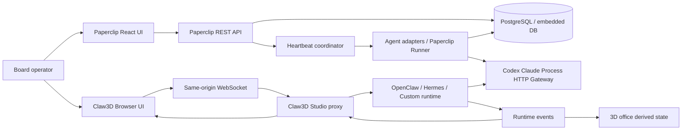

# BÁO CÁO BÀI TẬP LỚN
## Môn học: Quản lý dự án phần mềm
### Đề tài: Khảo sát và phân tích hệ sinh thái Paperclip và Claw3D

**Sinh viên:** .............................................................  
**Mã sinh viên:** .............................................................  
**Lớp/Nhóm:** .............................................................  
**Giảng viên hướng dẫn:** .............................................................  
**Hà Nội – 2026**

---

# MỤC LỤC

1. Lời mở đầu  
2. Phần 1. Tổng quan đề tài  
3. Phần 2. Phân tích hệ thống Paperclip  
4. Phần 3. Phân tích hệ thống Claw3D  
5. Phần 4. Công nghệ và thiết kế hệ thống  
6. Phần 5. Cài đặt, vận hành và kiểm thử  
7. Phần 6. Đánh giá kết quả  
8. Kết luận  
9. Tài liệu tham khảo  

---

# LỜI MỞ ĐẦU

Sự phát triển của mô hình ngôn ngữ lớn làm xuất hiện các hệ thống trong đó nhiều AI agent cùng tham gia vào một quy trình làm việc. Khi số lượng agent tăng, việc quản lý nhiệm vụ, quyền thực thi, chi phí, trạng thái phiên làm việc và kết quả đầu ra trở thành một bài toán quản lý dự án phần mềm. Một giao diện trò chuyện đơn lẻ không đủ để trả lời các câu hỏi: agent nào đang làm việc, công việc có được giao đúng người hay chưa, ngân sách còn bao nhiêu, kết quả đã được kiểm duyệt chưa và hệ thống có thể phục hồi ra sao sau khi một tiến trình dừng đột ngột.

Báo cáo này khảo sát source code trong workspace gồm hai phần chính. **Paperclip** là control plane điều phối công ty AI, quản lý công ty, agent, mục tiêu, issue, heartbeat, ngân sách, quyền hạn, workspace và adapter thực thi. **Claw3D** là lớp Studio trực quan hóa và tương tác, đưa trạng thái agent vào giao diện văn phòng 3D, đồng thời cung cấp cầu nối WebSocket tới gateway và các runtime bên ngoài.

Mục tiêu của báo cáo là mô tả kiến trúc, các thành phần, các luồng nghiệp vụ và các tính năng đã thể hiện trong mã nguồn. Nội dung được đối chiếu với `README.md`, `ARCHITECTURE.md`, tài liệu `doc/GOAL.md`, `doc/PRODUCT.md`, `doc/SPEC-implementation.md` và các module TypeScript/JavaScript trong repository.

---

# PHẦN 1. TỔNG QUAN ĐỀ TÀI

## 1.1. Bài toán đặt ra

Một doanh nghiệp vận hành bằng AI cần các chức năng tương tự một hệ thống quản lý dự án truyền thống, nhưng phải bổ sung lớp điều phối thực thi tự động. Dữ liệu không chỉ gồm tên công việc và trạng thái. Hệ thống còn phải lưu agent chịu trách nhiệm, cây mục tiêu, phiên chạy, workspace, công cụ được cấp, chi phí, yêu cầu phê duyệt, lịch sử hoạt động và bằng chứng kết quả.

Bài toán có bốn yêu cầu chính:

- Tổ chức agent theo công ty và cây báo cáo.
- Giao việc, checkout nguyên tử, chạy heartbeat và theo dõi tiến độ.
- Kiểm soát quyền, ngân sách, approval gate và khả năng dừng/phục hồi.
- Cung cấp giao diện quan sát trực quan cho người vận hành.

## 1.2. Mục tiêu của hệ thống

Paperclip hướng tới một vòng lặp hoàn chỉnh: người dùng tạo công ty và mục tiêu, tạo agent, giao issue, agent thực thi qua adapter, kết quả được ghi nhận trong activity log, chi phí được tổng hợp và người dùng có thể can thiệp ở bất kỳ bước nào.

Claw3D bổ sung cách quan sát giàu ngữ cảnh. Thay vì chỉ đọc log, người vận hành nhìn thấy agent trong văn phòng 3D, trạng thái bàn làm việc, hoạt động phòng họp, tiến trình kiểm thử, pull request và các sự kiện runtime.

## 1.3. Phạm vi khảo sát

Phạm vi Paperclip gồm `server`, `ui`, `packages/db`, `packages/shared`, `packages/adapters`, `packages/paperclip-runner`, `cli` và các tài liệu đặc tả. Phạm vi Claw3D gồm `claw3d/src`, `claw3d/server`, gateway adapters, Studio API routes, agent workspace, office scene và office builder.

Báo cáo không coi OpenClaw là một module được xây dựng trong repository. OpenClaw/Hermes là runtime bên ngoài. Paperclip và Claw3D chỉ kết nối, điều phối hoặc trình bày trạng thái của runtime đó.

---

# PHẦN 2. PHÂN TÍCH HỆ THỐNG PAPERCLIP

## 2.1. Vai trò của Paperclip

Paperclip là control plane cho các công ty AI. Một instance có thể chứa nhiều company. Company là đối tượng gốc của dữ liệu nghiệp vụ, còn agent là nhân sự AI thuộc company. Paperclip không trực tiếp biến mình thành model AI. Nó cung cấp bộ điều khiển và các adapter để khởi chạy, tiếp tục, quan sát và dừng tác vụ ở môi trường bên ngoài.

Các lớp chính được mô tả trong `doc/GOAL.md` và `doc/PRODUCT.md` gồm:

- Đăng ký company, goal và cây tổ chức.
- Quản lý agent, adapter type, model, instruction, skill, tool và secret.
- Quản lý issue, parent/sub-issue, blocker, comment, document và work product.
- Heartbeat, session, execution workspace và runtime service.
- Budget, cost event, usage, quota và cơ chế auto-pause.
- Activity log, approval, recovery và kiểm soát quyền.
- REST API, agent API, CLI và giao diện React.

## 2.2. Thành phần kiến trúc

### 2.2.1. Server

`server/` là backend Node.js/TypeScript dựa trên Express. Server cung cấp API cho company, agent, project, goal, issue, comment, connection, adapter, heartbeat, cost, budget, workspace và các tính năng mở rộng. Các service chịu trách nhiệm kiểm tra company boundary, quyền của board hoặc agent, ghi activity log và thực hiện giao dịch với database.

`server/src/services/heartbeat.ts` là điểm điều phối vòng đời chạy agent. Các module con trong `server/src/services/heartbeat/` tách phần chuẩn bị run, workspace, session, runtime selection, execution, completion, retry, recovery và run log. Cách tách này giúp việc admission, ownership, cancellation và settlement được theo dõi rõ ràng.

### 2.2.2. Database

`packages/db/` định nghĩa schema bằng Drizzle ORM. Các bảng đại diện cho company, agent, project, goal, issue, comment, heartbeat run, cost event, budget policy, activity, connection, workspace và các bản ghi phục hồi. Khi schema thay đổi, repository yêu cầu cập nhật schema/export, chạy `pnpm db:generate`, rồi kiểm tra typecheck.

Khi `DATABASE_URL` không được đặt, môi trường phát triển dùng embedded PostgreSQL/PGlite theo cấu hình của repository. Các ranh giới company được bảo vệ ở route và service, không chỉ dựa vào bộ lọc ở giao diện.

### 2.2.3. Shared contracts

`packages/shared/` chứa type, validator, constant, API path, telemetry contract và các mô hình dùng chung giữa server, UI, adapter và CLI. Lớp này giúp thay đổi API hoặc schema được đồng bộ thay vì để mỗi package tự định nghĩa một dạng dữ liệu khác nhau.

### 2.2.4. Agent adapters

`packages/adapters/` chứa adapter cho Claude, Codex, Gemini, OpenCode, Pi, Cursor, Grok, HTTP/process và OpenClaw gateway. Adapter định nghĩa cách kiểm tra môi trường, tạo command, truyền prompt, nhận output, đọc credential và xử lý lỗi. `packages/paperclip-runner/` cung cấp Runner native và các transport ACP cho những runtime được đủ điều kiện.

### 2.2.5. UI và CLI

`ui/` là ứng dụng React/Vite cho board operator. `cli/` cung cấp bin `paperclipai` để người dùng hoặc agent thao tác qua terminal. Hai bề mặt này gọi cùng API và phải tôn trọng cùng company scope, permission và activity semantics.

## 2.3. Các đối tượng nghiệp vụ

### 2.3.1. Company và goal

Company lưu mục tiêu kinh doanh, trạng thái và cấu trúc tổ chức. Goal tạo thành cây liên kết từ mission cấp company xuống các công việc cụ thể. Nhờ parentage, agent có thể giải thích một issue phục vụ mục tiêu nào.

### 2.3.2. Agent

Agent có tên, vai trò, người quản lý, capabilities, adapter type và adapter configuration. Cấu hình có thể bao gồm model, instruction, skill, tools, trust, channels, secret binding, runtime, workspace strategy và giới hạn chi phí. Agent có trạng thái hoạt động và lịch sử heartbeat.

### 2.3.3. Issue

Issue là đơn vị công việc chính. Issue hỗ trợ mã định danh ổn định, parent/sub-issue, assignee duy nhất, blocker, comment, document, attachment, work product và review/approval handoff. Checkout nguyên tử bảo đảm hai heartbeat không cùng nhận một issue.

### 2.3.4. Heartbeat run

Heartbeat là lần Paperclip yêu cầu agent kiểm tra hàng đợi và thực hiện một công việc. Run lưu agent, issue, session, workspace, adapter, trạng thái, output, cost và các event. Khi tiến trình thất bại, hệ thống phân biệt lỗi provider, lỗi runtime, cancellation, pause, budget hold và trạng thái cần recovery.

## 2.4. Luồng chính của Paperclip

### 2.4.1. Luồng khởi tạo công ty

1. Board gửi yêu cầu tạo company.
2. Server xác thực actor và tạo company cùng goal gốc.
3. Board tạo agent đầu tiên và cấu hình adapter.
4. Agent được gắn vào org tree, có thể được chọn làm primary agent của người dùng.
5. UI đọc dữ liệu company, agent và goal qua API để hiển thị dashboard.

### 2.4.2. Luồng giao và thực thi issue

1. Board hoặc agent tạo issue, chọn parent, priority và assignee.
2. Heartbeat admission kiểm tra company, permission, pause, budget, blocker và ownership.
3. Issue được checkout nguyên tử và chuyển sang `in_progress`.
4. Server chuẩn bị context, workspace, secret, tool authority và session.
5. Adapter khởi chạy Codex/Claude/process/HTTP/gateway hoặc Runner.
6. Output và run events được ghi nhận, đồng thời cost event được gắn với company, agent, project và issue.
7. Adapter trả completion hoặc failure.
8. Server settlement cập nhật issue, run, activity và các recovery obligation.

### 2.4.3. Luồng dừng và phục hồi

Board có thể pause agent hoặc issue. Budget hard-stop có thể tạm dừng thực thi khi vượt ngưỡng. Khi tiến trình dừng bất thường, recovery giữ ownership và session evidence, không tự động lặp lại tool call nguy hiểm. Nếu không thể tiếp tục an toàn, Paperclip tạo recovery action hiển thị cho operator.

### 2.4.4. Luồng kết nối Codex/Claude

AI connection lưu thông tin credential theo cơ chế secret. Với Codex local, Paperclip có thể dùng ChatGPT subscription qua Codex CLI hoặc dùng API key. Browser/device login tạo một credential home riêng, loại bỏ API key khỏi môi trường con và đưa URL/code vào UI. Lệnh `codex` phải tồn tại trên execution host đối với những nền tảng không có Runner native đủ điều kiện.

## 2.5. Nhóm tính năng chính

- **Quản lý tổ chức:** company, org tree, role, reporting line, primary agent.
- **Quản lý công việc:** issue list/board, parentage, assignee, blocker, filter, search, sort, Mine và routine tasks.
- **Điều phối agent:** heartbeat, session resume, runner selection, cancellation, recovery và monitor.
- **Governance:** approval gate, request confirmation, human wait, permission key, task privacy và audit log.
- **Chi phí:** cost events, token/request usage, monthly budget, spend rollup, threshold và auto-pause.
- **Workspace:** project repository, execution workspace, checkout, repository pin, preparation và cleanup.
- **Kết nối:** OpenAI, Anthropic, GitHub, Slack, Discord, Telegram, Teams, MCP gateway và custom provider.
- **Tài sản công việc:** documents, attachments, work products, artifact uploads và run evidence.
- **Agent-facing API:** API key bearer auth, task read/write, heartbeat report, comments, cost report và skill operations.
- **CLI:** tạo company/agent/task, đọc trạng thái, báo cáo run và thao tác từ môi trường terminal.

## 2.6. Bảo đảm dữ liệu và quyền

Mọi domain entity phải gắn company. API kiểm tra actor là board hay agent, API key được hash, agent key không truy cập company khác. Mutation ghi activity log. Các quyết định execution không được suy ra chỉ từ UI. Server phải kiểm tra lại authority khi dispatch, retry và recovery.

---

# PHẦN 3. PHÂN TÍCH HỆ THỐNG CLAW3D

## 3.1. Vai trò của Claw3D

Claw3D là ứng dụng Next.js và Studio dành cho việc quan sát, trò chuyện và điều khiển AI agent trong một văn phòng 3D. README và `ARCHITECTURE.md` xác định Claw3D là visualization and interaction layer, không phải runtime agent. Agent, session, approval và execution vẫn thuộc gateway kết nối.

Claw3D hiện hỗ trợ OpenClaw Gateway, Hermes, direct HTTP custom runtime và built-in demo gateway. Nó có `/office`, `/office/builder`, agents workspace, chat, settings, approvals, analytics, GitHub review, QA monitoring và các không gian tương tác khác.

## 3.2. Kiến trúc bốn lớp

### 3.2.1. Browser UI

Các component trong `claw3d/src/features/agents` hiển thị danh sách agent, chat, transcript, approval, settings và runtime event. `src/features/office` và `src/features/retro-office` dựng scene Three.js, desk, room, actor, navigation, animation và overlay.

### 3.2.2. Studio API routes

Các route trong `claw3d/src/app/api` xử lý settings, runtime custom, voice, browser preview, task store và media. Client không đọc filesystem trực tiếp. Các thao tác với token, file cục bộ, SSH hoặc biến môi trường nằm ở server.

### 3.2.3. Studio WebSocket proxy

Browser mở WebSocket same-origin tới `/api/gateway/ws`. Custom server trong `claw3d/server` nhận kết nối, nạp cấu hình gateway và mở WebSocket thứ hai tới OpenClaw/Hermes. Proxy chuyển tiếp frame giữa hai phía, nhờ đó browser không cần kết nối trực tiếp tới gateway.

### 3.2.4. Gateway/runtime

Gateway là source of truth của agent records, sessions, approvals, files và runtime streams. Claw3D gọi các method của gateway, nhận event và tạo state dẫn xuất. Demo adapter mô phỏng các method như `agents.list`, `agents.create`, `agents.update`, `agents.delete`, `agents.files.get`, `agents.files.set`, `chat.send` và `agent.wait`.

## 3.3. Luồng kết nối Claw3D

1. Người dùng mở Studio.
2. UI đọc settings qua `/api/studio`.
3. Người dùng chọn OpenClaw, Hermes, Demo, Local, Claw3D hoặc Custom backend.
4. Browser mở WebSocket same-origin.
5. Studio proxy đọc URL/token và tạo kết nối tới gateway.
6. Gateway trả capabilities, agent list, sessions và event stream.
7. UI cập nhật agent workspace và office dựa trên event.
8. Tin nhắn chat, approval hoặc mutation được gửi qua proxy tới gateway.

## 3.4. Luồng hoạt động trong văn phòng 3D

1. Runtime stream phát event agent đang chạy, dùng tool, chờ approval hoặc hoàn thành.
2. `runtimeEventBridge` và các store chuẩn hóa event thành trạng thái agent.
3. `eventTriggers`, `deskMonitor` và các module office suy ra hoạt động không gian.
4. Actor được gán desk/room, đổi animation và hiển thị action text, file path hoặc terminal line.
5. Overlay cung cấp context, chat, monitor và điều khiển session.
6. Khi event mới đến, scene cập nhật theo state dẫn xuất thay vì gọi mutation 3D trực tiếp.

## 3.5. Các tính năng chính của Claw3D

- **Agent workspace:** xem danh sách, chọn agent, chat, transcript, session và trạng thái.
- **Agent management:** tạo, đổi tên, xóa, sửa profile, file cấu hình và quyền.
- **Approvals:** hiển thị yêu cầu cần duyệt và gửi quyết định qua gateway.
- **Runtime monitoring:** theo dõi run, logs, tool call, terminal, file đang sửa và event.
- **3D retro office:** desk, room, navigation, presence, avatar, animation và activity cue.
- **Office builder:** chỉnh layout, desk assignment, room và lưu bố cục Studio.
- **Standup/GitHub/Jira:** cung cấp không gian vận hành và tổng hợp hoạt động tích hợp.
- **QA/log monitoring:** xem pipeline, log và trạng thái kiểm tra trong cùng không gian.
- **Gym và janitor:** tạo trải nghiệm rèn skill, reset session và làm sạch context.
- **Custom runtime:** proxy HTTP tới `GET /health`, `GET /state`, `GET /registry` và `POST /v1/chat/completions`.
- **Demo mode:** chạy built-in gateway để khám phá office mà không cài runtime thật.
- **Local persistence:** lưu gateway settings, focused agent, desk assignment, office state và UI preference ở Studio.
- **Rate limiting/access gate:** `claw3d/server/access-gate.js` giới hạn thử đăng nhập và bảo vệ API.

## 3.6. Ranh giới dữ liệu

Gateway-owned state gồm agent, session, approval, runtime event và agent files. Studio-owned state chỉ gồm cấu hình kết nối và preference trình bày. Claw3D không tạo bản sao cạnh tranh của agent record và không ghi trực tiếp vào file cấu hình OpenClaw. Đây là nguyên tắc quan trọng để tránh dữ liệu UI lệch với runtime.

---

# PHẦN 4. CÔNG NGHỆ VÀ THIẾT KẾ HỆ THỐNG

## 4.1. Công nghệ Paperclip

| Nhóm | Công nghệ và vai trò |
|---|---|
| Backend | Node.js, TypeScript, Express |
| Frontend | React, Vite, TypeScript, Tailwind/shadcn-style components |
| Database | PostgreSQL, embedded PostgreSQL/PGlite khi phát triển |
| ORM/schema | Drizzle ORM và migration |
| Runtime | Codex, Claude, Gemini, OpenCode, Pi, Cursor, process, HTTP, OpenClaw |
| Protocol | ACP/ACPX, WebSocket, REST, bearer API key |
| Tooling | pnpm workspace, Vitest, Playwright, Rust Runner |
| Storage | Database, local workspace, object storage cho artifact/run evidence |

## 4.2. Công nghệ Claw3D

| Nhóm | Công nghệ và vai trò |
|---|---|
| Web framework | Next.js, React, TypeScript |
| 3D | Three.js và các module retro-office |
| Transport | HTTP API và WebSocket proxy |
| Runtime adapters | OpenClaw, Hermes, custom HTTP, demo gateway |
| Persistence | JSON-backed Studio settings và local UI state |
| Kiểm thử | Vitest, Playwright và các test fixture của ứng dụng |

## 4.3. Sơ đồ tổng thể



## 4.4. Thiết kế workflow quản lý dự án

Paperclip là nơi quản lý lifecycle và authority. Một workflow điển hình bắt đầu bằng mục tiêu, phân rã thành issue, checkout cho agent, thực thi, ghi event, review rồi settle. Claw3D là lớp quan sát và tương tác trong thời gian thực, giúp người dùng nhận biết agent đang ở đâu và đang làm gì.

Hai hệ thống có thể kết hợp theo mô hình: Paperclip giữ company, issue, budget và audit làm dữ liệu điều khiển; Claw3D kết nối gateway hoặc adapter để trình bày activity, chat và presence. Khi dùng Paperclip gateway adapter trong `claw3d/server/paperclip-gateway-adapter.js`, Claw3D đọc agents, issues, live runs và log từ Paperclip rồi chuyển chúng thành payload phù hợp với office.

---

# PHẦN 5. CÀI ĐẶT, VẬN HÀNH VÀ KIỂM THỬ

## 5.1. Cài đặt Paperclip

Yêu cầu Node.js theo `package.json`, pnpm 9 và môi trường PostgreSQL hoặc embedded database. Các bước cơ bản:

```bash
pnpm install
pnpm dev
```

Kiểm tra:

```bash
curl http://localhost:3100/api/health
curl http://localhost:3100/api/companies
```

Biến `DATABASE_URL` có thể bỏ trống trong môi trường phát triển để dùng database nhúng. Khi cần kiểm tra đầy đủ:

```bash
pnpm -r typecheck
pnpm test:run
pnpm build
```

## 5.2. Cài đặt Claw3D

```bash
cd claw3d
npm install
cp .env.example .env
npm run dev
```

Mở `http://localhost:3000`. Nếu dùng Demo gateway:

```bash
npm run demo-gateway
npm run dev
```

Sau đó kết nối Studio tới `ws://localhost:18789`. Với Hermes, chạy adapter Hermes trước rồi chọn Hermes backend trong UI. Với custom runtime, runtime cần cung cấp `/health`, `/state`, `/registry` và `/v1/chat/completions`.

## 5.3. Kịch bản kiểm thử đề xuất

| Mã | Kịch bản | Kết quả mong đợi |
|---|---|---|
| TC01 | Tạo company và goal | Company xuất hiện, goal gốc được liên kết |
| TC02 | Tạo agent và gán adapter | Agent có config, role và company đúng |
| TC03 | Tạo issue và checkout | Chỉ một heartbeat được quyền nhận issue |
| TC04 | Chạy agent thành công | Run, output, activity và cost được ghi |
| TC05 | Pause issue/agent | Run mới bị chặn, draft và trạng thái được giữ |
| TC06 | Vượt budget | Admission bị giữ hoặc agent auto-pause |
| TC07 | Mất provider | Failure có mã rõ ràng, recovery không lặp tool call |
| TC08 | Kết nối Claw3D Demo | Agent, chat và event xuất hiện trong office |
| TC09 | Kết nối WebSocket gateway | Proxy chuyển tiếp hai chiều, không lỗi CORS |
| TC10 | Tạo agent từ Claw3D | Gateway là source of truth, UI cập nhật event |
| TC11 | Builder lưu layout | Desk/room state được lưu phía Studio |
| TC12 | Custom runtime | Health/state/registry/chat hoạt động qua same-origin route |

## 5.4. Kết quả kiểm tra source

Repository có test unit, integration, browser và runner cho nhiều lớp. Paperclip có các test cho route, service, adapter, heartbeat, database, permission, recovery, model selection và Codex login. Claw3D có test cho runtime adapter, office state, gateway, layout và các luồng giao diện.

Việc chạy toàn bộ test phụ thuộc môi trường, phiên bản Node, database, native binary và runtime bên ngoài. Các test tích hợp provider thật hoặc gateway thật cần credential và dịch vụ tương ứng. Vì vậy báo cáo phân biệt giữa bằng chứng từ source/test fixture và kiểm thử live có provider bên ngoài.

---

# PHẦN 6. ĐÁNH GIÁ KẾT QUẢ

## 6.1. Kết quả đạt được

Paperclip đã hình thành một control plane có phạm vi rộng, trong đó company boundary, agent identity, task ownership, approval, budget và audit được đặt ở server. Kiến trúc adapter cho phép kết nối nhiều runtime mà không đưa logic provider vào heartbeat coordinator. Các tài liệu đặc tả, schema, shared type, API và UI được tổ chức thành nhiều package có ranh giới rõ.

Claw3D giải quyết bài toán quan sát bằng một giao diện khác biệt. WebSocket proxy giữ kết nối gateway ở phía Studio, còn office 3D dùng state dẫn xuất để biến event runtime thành hoạt động không gian. Demo gateway giúp phát triển UI mà không cần runtime bên ngoài, trong khi OpenClaw/Hermes/custom adapter mở rộng được cho môi trường thật.

## 6.2. Ưu điểm

- Phân tách control plane, adapter và runtime rõ ràng.
- Có company scope, permission, activity log và budget control.
- Issue hierarchy giúp truy vết từ công việc về mục tiêu.
- Có heartbeat, cancellation, recovery và session semantics.
- Claw3D tạo trải nghiệm quan sát trực quan và giàu ngữ cảnh.
- Gateway-first giúp tránh cạnh tranh source of truth.
- Có test và tài liệu kiến trúc cho nhiều đường chạy quan trọng.

## 6.3. Hạn chế và rủi ro

- Nhiều runtime bên ngoài khiến việc triển khai phụ thuộc môi trường.
- Native Runner có điều kiện platform, libc và binary riêng.
- Claw3D hiện là Studio local-first, chưa phải nền tảng multi-user.
- Browser vẫn là một phần trust boundary khi cấu hình gateway được nạp vào runtime UI.
- Office 3D tăng chi phí rendering và cần kiểm soát hiệu năng với fleet lớn.
- Kiểm thử live cần gateway, credential, repository hoặc provider thật.
- Hai hệ thống có nhiều khái niệm runtime khác nhau, cần mapping rõ khi tích hợp sâu.

## 6.4. Đề xuất cải tiến

- Chuẩn hóa capability contract giữa Paperclip agent, gateway adapter và Claw3D.
- Bổ sung màn hình hiển thị rõ nguồn dữ liệu: Paperclip, gateway hay Studio state.
- Tăng test end-to-end cho luồng Paperclip issue → adapter → Claw3D presence.
- Bổ sung health check và chẩn đoán môi trường cho Codex/Claude trước khi login.
- Tách telemetry, observability và run log theo đúng mục đích lưu trữ.
- Bổ sung benchmark cho office khi có nhiều agent và event đồng thời.
- Thiết kế auth/multi-user nếu Claw3D được triển khai như sản phẩm chia sẻ.

---

# KẾT LUẬN

Paperclip và Claw3D giải quyết hai mặt của cùng một hệ thống AI agent. Paperclip cung cấp nền tảng quản trị và điều phối, bảo đảm công việc có mục tiêu, người chịu trách nhiệm, quyền thực thi, ngân sách, lịch sử và cơ chế phục hồi. Claw3D cung cấp lớp quan sát và tương tác trực quan, chuyển event runtime thành một không gian văn phòng 3D để người dùng dễ hiểu hoạt động của đội agent.

Qua khảo sát source code, có thể thấy kiến trúc được xây dựng theo hướng giữ dữ liệu nghiệp vụ và quyền hạn ở backend/runtime, dùng adapter làm ranh giới provider, dùng event/state dẫn xuất cho UI và hạn chế tạo source of truth thứ hai. Đây là nền tảng phù hợp cho việc phát triển hệ thống quản lý dự án phần mềm có AI agent tham gia ở quy mô lớn hơn.

---

# TÀI LIỆU THAM KHẢO

1. Paperclip, `README.md`, source repository hiện tại.
2. Paperclip, `doc/GOAL.md`.
3. Paperclip, `doc/PRODUCT.md`.
4. Paperclip, `doc/SPEC-implementation.md`.
5. Paperclip, `doc/DEVELOPING.md`.
6. Paperclip, `doc/DATABASE.md`.
7. Claw3D, `README.md`.
8. Claw3D, `ARCHITECTURE.md`.
9. Claw3D, `TUTORIAL.md` và `docs/runtime-profiles.md`.
10. Mã nguồn `server/`, `ui/`, `packages/`, `cli/` của Paperclip.
11. Mã nguồn `claw3d/src/` và `claw3d/server/` của Claw3D.
